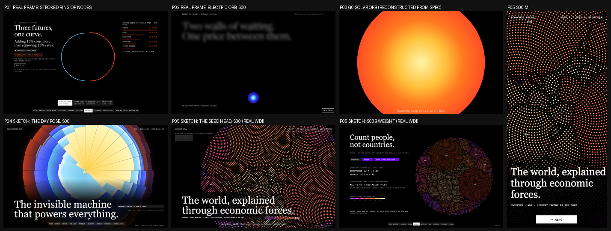

# Visual design: Economic Atlas ("The World, Explained Through Economic Forces")

This document covers phases 14-16: reference research, three competing concepts with a scored
selection, and the experience blueprint. The motion bible (phase 17) is `MOTION_SYSTEM.md`.
Author: Creative Director (task P05-CD-001), 2026-10-10.

## Contents

0. [Binding inputs](#0-binding-inputs)
1. [Reference research (phase 14)](#1-reference-research-phase-14)
2. [Three concepts and the selection (phase 15)](#2-three-concepts-and-the-selection-phase-15)
3. [Experience blueprint (phase 16)](#3-experience-blueprint-phase-16)
4. [Signature interactions](#4-signature-interactions)
5. [Copy deck](#5-copy-deck)
6. [Placeholder bindings and data requests](#6-placeholder-bindings-and-data-requests)
7. [Hard rejection criteria](#7-hard-rejection-criteria)

---

## 0. Binding inputs

These are inputs to the design. The design does not choose them.

- **Shared language.** `design/reference-analysis.md`, `design/interaction-inventory.md`, `shared/design-tokens/tokens.css` and `design/fonts/DECISION.md` (workspace root). Fonts: Newsreader (display) and JetBrains Mono (everything else). The ghost-word state is opacity 0.55 plus a 12px blur (ENGINEERING_DECISIONS #10).
- **What other projects own** (`docs/DESIGN_AUDIT.md`, ENGINEERING_DECISIONS #14, #15, #19, #21, and the P03/P04 VISUAL_DESIGN docs). Evidence I opened for this task:
  - P01 `artifacts/evidence/stage-b3/1440x900/06-futures-a-busier.png` (real frame)
  - P02 `artifacts/evidence/stage-a/1440x900/00-s00-t1250.png` and `00-s00-t4550.png` (real frames)
  - P04 `design/sketches/distinctness-sheet.png` and `rose-s00-d.png`
  - P03 has no rendered frames anywhere yet, so I reconstructed its G0 orb from its own spec (P03 VISUAL_DESIGN 3.3) as `design/sketches/p03-g0-reconstruction.png`

  What each project owns:
  - **P01** owns an oversized *stroked* ring with nodes on its circumference, chords inside, a stepping horizon dial, and a rising spectral horizon arc as its closing.
  - **P02** owns rectilinear depth walls and a small, smooth Electric glow orb that contracts to a marker and grows back.
  - **P03** owns a Solar orb (a flat concentric glow, at least 120vh) that resolves into a sphere of square grid cells, an equal-area unwrap, a vertical core of strata, and a push into the cell surface.
  - **P04** owns a filled, area-true 24-petal rose: wedges, black spokes, and radial band fills from the centre.
- **Data read on 2026-10-10** from `site/public/data/` (commit `f353aec`, "Build status: P05 data passed"):
  - **Coverage.** 217 countries; 79 aggregates excluded (`facts.aggregates`).
  - **GDP per capita, PPP.** Latest year 2025, with 185 countries (`facts.gdppc_ppp_latest_year`, `facts.gdppc_ppp_countries_latest`).
  - **Population.** The world total is `facts.world_pop_billion_latest` = 8.19 BN (sum over the 217 countries).
  - **One seed per million people.** I applied the rule in this document (`max(1, round(pop / 1M))` per country) to the 185 countries that have a 2025 PPP value. That gives **8,005 seeds in 2025** (7,979 million people) and **5,202 seeds in 1990** (5,173 million). In 2025, 32 countries holding 0.21 BN people have no PPP value.
  - **Clusters.** k = 3; silhouette 0.225; 4 of 165 countries have a negative silhouette; Ward vs k-means ARI 0.48.
  - **Correlations.** Strongest pair: income vs productivity, rho 0.97 (n 177). Weakest: agriculture vs industry share, rho -0.004 (n 198).
  - **Convergence.** The primary 1990-2025 PPP slope is -0.37 (HC3 CI -0.59 to -0.15), with a half-life of 174 years. The 1960-2024 constant-USD slope is -0.03 (CI -0.22 to 0.17), so its CI spans 0.
- **Contracts.** `docs/DATA_CONTRACTS.md` plus 16 schemas in `data/contracts/`. Section 6 binds every placeholder to those field names. Anything missing is a numbered data request (DR-n).
- **Honesty rules from the data** (binding on every view):
  1. PPP, constant USD, current USD and Maddison dollars never share an axis, a legend, a disc or a readout. The unit is visible in every view.
  2. Clusters are weak and are presented as descriptive groups.
  3. Correlations and convergence carry their "not causal" copy (`facts.strings.not_causal`, `convergence.copy.*`).
  4. Aggregates are never ranked or drawn as countries.
  5. The WDI vintage (`meta.vintage.text`), the WDI and Maddison attributions, and the IMF exclusion (`facts.strings.imf_excluded`) are on screen.
  6. Narratives come only from `narratives.json` templates and inputs.
- **Sketches** (original, rendered from the real artifacts):
  - `design/sketches/seed-s00-d.png` and `seed-s00-m.png`: S00 end state, D and M
  - `design/sketches/seed-s03b-d.png`: S03b, China and India set aside
  - `design/sketches/distinctness-sheet.png`: the contact-scale comparison of P01 to P05 (section 2)

  The generator is `design/sketches/render_seed_sketch.py` with `territories.py` (`uv run --with numpy python design/sketches/render_seed_sketch.py`).
- **What we take from the reference** (principles only, never assets or copy):
  - black stages lit by one luminous form
  - oversized serif statements revealed word by word through blur
  - uppercase mono for all UI and body copy
  - 100dvh sticky stages in long tracks
  - threshold-stepped 1.2s settles
  - 4-segment story cards
  - an argument card stack
  - a square blur bottom nav and a mobile current-section pill
  - a closing that echoes the opening

  We do **not** take its 164vw ring dial. Our circle is a filled field of grains; it has no outline and it never rotates.

### The Seed Head: encoding (binding)

The giant circular element is **the Seed Head**: the world's people as one disc of luminous grains, sorted by an economic indicator so the highest value sits at the core.

| Aspect | Rule |
|---|---|
| **Seed** | One seed = one million people. A country holds `max(1, round(pop / 1,000,000))` slots, rounded **per country**, so the count never depends on the sort. Each of its seeds is drawn at area `pop / (slots × 1,000,000)` of a full seed, so **total ink is exactly proportional to people**. A country under 500,000 people holds one slot drawn at its true fraction of a seed. The legend says `1 SEED ≈ 1 MILLION PEOPLE · SMALLEST SEEDS: COUNTRIES UNDER 500,000` |
| **Lattice** | A Vogel (Fermat) spiral. Slot `i` sits at radius `s × sqrt(i + 0.5)` and angle `i × 137.508°`. Every slot has the same area, `s²`. The spacing `s` is constant across years, so **the disc's area is the world's people**: it holds 5,202 slots in 1990 and 8,005 in 2025, and new slots are added at the rim |
| **Territory** | Every country owns one contiguous territory of exactly its slot count. The territory is seeded at the country's rank position, so the indicator's highest value is at the core and the lowest at the rim. The layout is computed offline (DR-1) |
| **Order** | `rankings.json` order: descending by value, ties broken by iso3, countries with a value only. **Aggregates never appear** |
| **Seed size** | A full seed has radius `0.40 s`. A **seam seed** (one whose lattice neighbour belongs to a higher-ranked country) has radius `0.22 s`, which draws a one-seed-wide dark seam on the lower side of every border. Territories of 6 seeds or fewer never seam, so small countries never dissolve |
| **Colour** | The binned Spectral ramp of the sorted indicator (below), with 7 bins whose edges come from DR-7. Each seed carries a small luminous radial gradient (bin colour at the edge, a lighter tint at 42% / 38% of its box): grains glow, never flat swatches |
| **Count modes** | **PEOPLE** (the default above). **COUNTRIES**: one seed per country, all equal, on a Vogel lattice of `n` slots at the same disc radius. This is the unweighted view |
| **No data** | Countries without a value in the active year are **never in the disc and never at its rim**. They form a separate hollow set (1px white outlines at 60%, one per million people) beside the disc, captioned `NO {{label}} VALUE: {{n}} COUNTRIES · {{bn}} BN PEOPLE (NOT RANKED)` |
| **Set aside** | A country excluded from a sample (China and India in S03b, territory changes and missing start data in S04 and S05) is drawn hollow (a 0.8px outline in its bin colour). It stays in place and in the disc's area |
| **Unit** | Every view prints `SORTED BY {{indicator.label}} · {{indicator.unit}}` and the legend's unit line. When the indicator is a money level, the basis is named in full: `CONSTANT 2021 INTL $ (PPP)`, `CONSTANT 2015 US$`, `CURRENT US$` |
| **Labels** | Iso3 codes are drawn at territory centroids for countries over 90M people (D), 150M (T) or 250M (M), in 11px mono with a 3px black paint-order stroke. Hover or tap names any country |
| **Never** | Any of the following: an outline or outer circle; guide rings or concentric gridlines; a tick ring; nodes or marks on a circumference; chords; rotation or a stepped angle; a sweep; wedges, petals or spokes; square cells; sphere shading or a limb; a smooth glow disc; a radial-gradient fill instead of grains. Seed area never encodes the indicator. A territory is never split, and no-data people are never at the rim |

**Why "highest at the core".** Area inside any radius is people. With the richest at the core, the circle of radius `r` holds the `π r² / s²` million people who live in the highest-income countries. The disc is therefore an area-true cumulative distribution, read from the core outward ("Pen's parade", rolled up; reference 25).

### Colour semantics (project 05 rule set)

The accent stays **Spectral** (orange core, magenta rim), as the plan sets. The justification is that the ramp *is* the data: the warm core is high value and the magenta rim is low value, so the accent and the encoding never compete.

| Role | Value | Contrast on `#000` | Rule |
|---|---|---|---|
| Bin 0 (lowest) | `#9A3CE0` | 4.1 | Edge colour. The highlight tint is computed (+40% toward white) |
| Bin 1 | `#C21FD6` | 4.5 | |
| Bin 2 | `#FF2F7A` | 5.9 | |
| Bin 3 | `#FF4F3F` | 6.4 | |
| Bin 4 | `#FF6A2B` | 7.4 | |
| Bin 5 | `#FFB26B` | 11.8 | |
| Bin 6 (highest) | `#FFE6C9` | 17.4 | |
| Diverging indicators (growth, convergence residual) | Bins 0-2 below zero, bin 3 contains zero, bins 4-6 above | | The zero edge is written under the legend as `0` |
| **Violet `#690DE2` (fill only)** | 2.8 | | Active parameter blocks (white text, 7.6:1), the violet story card and notification card 2. **Never** a line, text, seed or data area |
| DERIVED overlays | `#58B8E1` (`--tag-derived`, 9.4) | | Fit lines, the sigma bracket on the legend and the CI hatch (45°, 1px at a 6px pitch, 50%) |
| PREDICTED | `#8FA2FF` (`--tag-predicted`) | | Peer-group chips and the group-disc captions only. Peer groups are shown by **position** (three discs), never by recolouring seeds |
| No data | White 1px outline at 60% | | Hollow set beside the disc |
| Text | `#fff`, and `rgba(255,255,255,.5)` at 13px and up | | Seed colours are never used for body text |

- **The ramp is monotone in luminance** (4.1 to 17.4), so order survives protan, deutan and tritan vision, and greyscale.
- Every bin passes 3:1 against black for graphics.
- Neighbouring bins differ in hue as well as luminance, and the legend is a 7-swatch mono strip with its edges written underneath (never a gradient bar).

### Uncertainty and honesty grammar

| Kind | Tag | Visual |
|---|---|---|
| WDI values (seed colours, paths, readouts) | OBSERVED | Solid seeds; 2px white paths |
| Territory layout, growth rates, index values, sigma, hhi5, fitted lines, half-lives, medians | DERIVED | Layout chip `OBSERVED VALUES · DERIVED LAYOUT`. Lines and brackets in `#58B8E1` |
| Fitted-line CI (HC3, plus bootstrap in the readout) | DERIVED | A `#58B8E1` 45° hatch with no edge line. **Never a solid fill** |
| Peer-group membership | PREDICTED | Position in one of three discs plus a `#8FA2FF` chip `PREDICTED · DESCRIPTIVE GROUP`. Seeds with negative silhouette are hollow |
| Correlation rho with CI | DERIVED | The readout plus `facts.strings.not_causal`, always visible beside it |
| Maddison long run | OBSERVED (values), DERIVED (spread) | **S02 card 4 only**, on its own axis, labelled `INTERNATIONAL-$ IN 2011 PRICES (MADDISON)`, never on the WDI domain |
| SIMULATED / SYNTHETIC | Never | Nothing on this site is simulated |

Every visual carries one chip: 13px mono, 8px padding, `#ffffff1a` background, in the tag colour from tokens. Where an artifact carries `tags`, **the chip text comes from the artifact**, not from this document.

**The footer is on every scene from S01 on** (12px mono, 50% white):
- `meta.vintage.text`
- `facts.strings.attribution_wdi`
- `facts.strings.attribution_owid` (on S02 card 4 and in the S08 footer)
- `facts.strings.imf_excluded` (S07 answer 7 and the S08 footer)

---

## 1. Reference research (phase 14)

Each reference was verified on 2026-10-10 by one of these methods:

- **C:** `curl -L` (desktop UA) returned HTTP 200, and the page title was read (quoted).
- **R:** the orchestrator's captured reference walk (`design/reference/`).
- **F:** a fact read from a file in this repository.

**The Motion column describes, it does not observe.** Unless the row is marked R, I did not watch the motion in a browser for this task, and the design does not claim it as an observed interaction.

Excluded after checking (not cited):

| URL | Result |
|---|---|
| visualcapitalist.com, "Visualizing the $105 trillion world economy in one chart" | 403 (bot check) |
| flowingdata.com, "A Day in the Life of Americans" | 403 (bot check) |
| imf.org/external/terms.htm and imf.org/en/About/copyright-and-terms | 403 Access Denied (the IMF exclusion rests on `docs/DATA_SOURCES.md`, not on a page I read) |
| w3.org WCAG 2.1 "Non-text Contrast" | 403 (bot check) on this run |
| nytimes.com interactive (Upshot) | 403 |
| sciencedirect.com (Vogel 1979) and its doi.org link | 403, and a JS redirect stub. Vogel's model is cited through reference 13 instead |
| dl.acm.org (Balzer et al., capacity-constrained point distributions) | 403 (bot check) |
| observablehq.com/@mbostock/phyllotaxis | 429 (Vercel checkpoint) |
| en.wikipedia.org/wiki/Pen%27s_Parade (capital P) | 404. The lowercase title is cited (#25) |

| # | Reference (URL) | Verified | Technique | Motion (described, not observed, unless R) | Strength for us | Implementation direction | Originality strategy |
|---|---|---|---|---|---|---|---|
| 1 | Blink Capital, https://blink.capital/ | R | 100dvh sticky stages, story cards, chat stack, blur bottom nav, one luminous form | Observed: 1.2s `cubic-bezier(.33,1,.68,1)` stepped settles, word blur reveal, instant nav jumps | The mandatory grammar | Principles only, through the shared shell and tokens | Our luminous form is a disc of people made of grains, not a ring. No dial, no rotation, no outline |
| 2 | World Bank, WDI dataset, https://datacatalog.worldbank.org/search/dataset/0037712 | C ("World Development Indicators - World Bank Data Catalog") | The source of record and its CC BY 4.0 licence | n/a | Licence and attribution wording | The footer attribution `facts.strings.attribution_wdi` plus `meta.vintage.text` on every scene | We show the vintage as a first-class fact, not small print |
| 3 | World Bank, WDI DataBank, https://databank.worldbank.org/source/world-development-indicators | C ("World Development Indicators \| DataBank") | Country x series x year table builder | Table refresh | The publisher's own comparison mental model: country, series, time | The ATLAS controls follow the same three axes, plus the index base | An editorial instrument, not a query table |
| 4 | Our World in Data, "Economic Growth", https://ourworldindata.org/economic-growth | C ("Economic Growth \| Our World in Data") | Explainers with sourced charts | Static | Sets the reader's expectations and shows sourcing discipline | One source line per visual | We do not repeat their line charts; growth lives in the catch-up plane |
| 5 | Our World in Data, "Economic Inequality", https://ourworldindata.org/global-economic-inequality | C ("Economic Inequality \| Our World in Data") | Distributions of income across people | Static | People-weighted versus country-weighted framing | S03b WEIGHT: COUNTRIES versus PEOPLE | We show the weighting as a physical change of the disc (coalesce and burst), with sigma read on the legend |
| 6 | OWID grapher, "GDP per capita" (Maddison), https://ourworldindata.org/grapher/gdp-per-capita-maddison | C ("GDP per capita \| Our World in Data") | Long-run series, 2011 international dollars | Map and line transitions | Our only non-WDI series | S02 card 4 only, on its own axis and unit | Never on the WDI domain |
| 7 | Maddison Project Database 2023, https://www.rug.nl/ggdc/historicaldevelopment/maddison/releases/maddison-project-database-2023 | C ("Maddison Project Database 2023 \| Releases \| Groningen Growth and Development Centre \| ...") | The origin record of the long-run series | n/a | Attribution and basis (2011 prices) | The `attribution_owid` string and the basis line on card 4 | n/a |
| 8 | World Bank, International Comparison Program, https://www.worldbank.org/en/programs/icp | C ("International Comparison Program (ICP)") | Where PPP conversion factors come from | n/a | Grounds "three different dollars" | S02 card 2 and S07 answer 1 | Units as three separate rows that never meet, never one chart with three lines |
| 9 | World Bank, "Country and Lending Groups", https://datahelpdesk.worldbank.org/knowledgebase/articles/906519-world-bank-country-and-lending-groups | C ("World Bank Country and Lending Groups – World Bank Data Help Desk") | Current income-group classification | n/a | Income groups are current labels | The inspector shows `INCOME GROUP (CURRENT WB LABEL)`. Never a sample split | n/a |
| 10 | Gapminder Tools, https://www.gapminder.org/tools/ | C (HTTP 200; the HTML sets no title, and the page source names `GAPMINDER_TOOLS`) | Animated bubbles: income x life expectancy over time | Bubbles move over the years (described) | The best-known animated country comparison | Our year transitions are keyed and integer-stepped like theirs, but the form is a disc of people | **Anti-template for the hero.** We never open on a bubble chart. The S04 plane is a sorted disc that coalesces into countries, so its origin is visible |
| 11 | Gapminder, "Dollar Street", https://www.gapminder.org/dollar-street | C ("Dollar Street - photos as data to kill country stereotypes") | Households sorted by income on one street | Scroll | "Sort the world by income" as a humane device | S00 "The Sort": the world sorted by income, made visible | People as grains, not photos. We never claim household incomes (we have country means only) |
| 12 | World Bank, "Atlas of Sustainable Development Goals 2023", https://datatopics.worldbank.org/sdgatlas/ | C ("Atlas of Sustainable Development Goals 2023") | The publisher's own scrollytelling over WDI | Scroll-driven chart transitions (described) | Shows that WDI can carry editorial scroll stories | The S03a year scrub and S04 transformation pacing | One luminous form across all scenes, not a new chart per section |
| 13 | Wikipedia, "Fermat's spiral", https://en.wikipedia.org/wiki/Fermat%27s_spiral | C ("Fermat's spiral - Wikipedia"; the page describes "the full model proposed by H. Vogel in 1979") | The Vogel sunflower model: radius ∝ sqrt(n), angle n × golden angle | n/a | Equal area per floret, so area is countable | The lattice rule in section 0 | The florets are people, sorted by an economic value |
| 14 | Wikipedia, "Phyllotaxis", https://en.wikipedia.org/wiki/Phyllotaxis | C ("Phyllotaxis - Wikipedia") | The botany of seed heads | n/a | A natural form that reads "grown", not "charted" | The name and the grain look | No botanical illustration, petals or stems |
| 15 | Wikipedia, "Golden angle", https://en.wikipedia.org/wiki/Golden_angle | C ("Golden angle - Wikipedia") | 137.508° spacing | n/a | Why the lattice has no rings or spokes | The constant in the lattice | n/a |
| 16 | Wikipedia, "Isotype (picture language)", https://en.wikipedia.org/wiki/Isotype_(picture_language) | C ("Isotype (picture language) - Wikipedia") | Countable units: one symbol = a fixed quantity | n/a | The honest way to say "eight billion" | `1 SEED ≈ 1 MILLION PEOPLE`, rounded per country, at true area | Units are grains in a spiral, not rows of figures |
| 17 | Wikipedia, "Power diagram", https://en.wikipedia.org/wiki/Power_diagram | C ("Power diagram - Wikipedia") | Weighted Voronoi assignment | n/a | The math behind capacity-constrained territories | DR-1: iterated power assignment on the lattice, plus an exact repair | The territories are made of grains, with seams, not polygon cells |
| 18 | Kcnarf, "d3-voronoi-treemap", https://github.com/Kcnarf/d3-voronoi-treemap | C ("GitHub - Kcnarf/d3-voronoi-treemap: D3 plugin which computes a treemap based on a Voronoi tesselation · GitHub") | Voronoi treemaps (the "world economy in one chart" look) | n/a | **Anti-reference.** The polygon-mosaic infographic we must not resemble | Rejection criterion 2 (no polygon outlines, no flat cells, no area = GDP) | Area is people, never money. Territories are grain fields sorted by a value, read core to rim |
| 19 | D3, "Pack", https://d3js.org/d3-hierarchy/pack | C ("Pack \| D3 by Observable") | Circle packing | Zoom transitions | **Anti-reference.** I sketched packed country bodies (section 2, iteration 2), and they read as this library chart and broke the circle | Rejected | n/a |
| 20 | Chart.js, "Bubble Chart", https://www.chartjs.org/docs/latest/charts/bubble.html | C ("Bubble Chart \| Chart.js") | A library bubble chart with gridlines and a legend box | Default grow-in | **Anti-reference** for the S04 catch-up plane | Rejection criterion 1: no gridlines, no box, no legend box, direct mono labels | The plane is born from the disc and keeps its grains and light |
| 21 | Data Viz Catalogue, "Bubble Chart", https://datavizcatalogue.com/methods/bubble_chart.html | C ("Bubble Chart - Learn about this chart and tools to create it") | Names the form and its pitfall: area, not radius, must carry the value | n/a | The S04 weighted view sizes seeds by area | Seed area ∝ initial population in the weighted sample (`weight`) | n/a |
| 22 | Wikipedia, "Convergence (economics)", https://en.wikipedia.org/wiki/Convergence_(economics) | C ("Convergence (economics) - Wikipedia") | Beta and sigma convergence, absolute versus conditional | n/a | Shared vocabulary | S04 and S05 copy; the "absolute only" line (`convergence.copy.absolute_only`) | n/a |
| 23 | Barro and Sala-i-Martin, "Economic Growth and Convergence across The United States", NBER w3419, https://www.nber.org/papers/w3419 | C ("Economic Growth and Convergence across The United States \| NBER"; authors read on the page) | The classic beta and sigma framing | n/a | The method lineage | S07 answer 2 cites the framing, and the half-life is shown only when defined | Convergence is shown as grains sliding in a plane, with honest null results |
| 24 | Wikipedia, "Purchasing power parity", https://en.wikipedia.org/wiki/Purchasing_power_parity | C ("Purchasing power parity - Wikipedia") | Why PPP and market dollars differ | n/a | Reader background | S02 card 2 | n/a |
| 25 | Wikipedia, "Pen's parade", https://en.wikipedia.org/wiki/Pen%27s_parade | C ("Pen's parade - Wikipedia") | People lined up by income | n/a | The economic reading of the disc: a parade rolled into a spiral | Section 0, "why highest at the core" | Our parade is rolled up; we never draw the parade itself |
| 26 | Wikipedia, "Elephant curve", https://en.wikipedia.org/wiki/Elephant_curve | C ("Elephant curve - Wikipedia") | People-weighted global income growth | n/a | Context for "count people, not countries" | S03b framing only | We do not compute within-country distributions, and we say so (S07 answer 3) |
| 27 | Wikipedia, "Silhouette (clustering)", https://en.wikipedia.org/wiki/Silhouette_(clustering) | C ("Silhouette (clustering) - Wikipedia") | Per-member fit to its cluster | n/a | Makes "weak groups" visible per country | S06: seeds ordered by silhouette inside each group disc; negative values are hollow | n/a |
| 28 | Wikipedia, "k-means clustering", https://en.wikipedia.org/wiki/K-means_clustering | C ("k-means clustering - Wikipedia") | The method | n/a | S07 answer 4 | Method names in the inspector chip | n/a |
| 29 | Wikipedia, "Spearman's rank correlation coefficient", https://en.wikipedia.org/wiki/Spearman%27s_rank_correlation_coefficient | C ("Spearman's rank correlation coefficient - Wikipedia") | Rank correlation | n/a | Rank is exactly what the disc encodes | S06 RELATIONS: ORDER BY A, LIGHT BY B. High rho reads as a clean core-to-rim ramp, and rho near 0 reads as speckle | A correlation you can see as order versus noise, never a scatter matrix |
| 30 | Wikipedia, "Herfindahl-Hirschman index", https://en.wikipedia.org/wiki/Herfindahl%E2%80%93Hirschman_index | C ("Herfindahl–Hirschman index - Wikipedia") | Concentration index | n/a | `hhi5` explanation | ATLAS indicator note with `facts.strings.hhi_caveat` | n/a |
| 31 | Claus O. Wilke, *Fundamentals of Data Visualization*, "Visualizing proportions", https://clauswilke.com/dataviz/visualizing-proportions.html | C ("Fundamentals of Data Visualization") | When parts of a whole read well | n/a | Supports area-as-people with countable units | The no-data set is shown beside, not inside, the whole | n/a |
| 32 | MDN, `WebGL2RenderingContext.drawArraysInstanced()`, https://developer.mozilla.org/en-US/docs/Web/API/WebGL2RenderingContext/drawArraysInstanced | C ("WebGL2RenderingContext: drawArraysInstanced() method - Web APIs \| MDN") | Instanced quads | n/a | 8,005 seeds in one draw call, tweened on the GPU | MOTION_SYSTEM 9.1 | n/a |
| 33 | Lenis, https://lenis.darkroom.engineering/ | C ("Lenis – Smooth Scroll") | Normalized smooth scroll | Inertial scroll | The reference's own smoothing | The shared shell's one progress loop | n/a |
| 34 | The Pudding, "Human Terrain", https://pudding.cool/2018/10/city_3d/ | C ("Human Terrain") | People as a physical surface | Scroll-driven camera (described) | People made tangible as matter | Seeds as people | No 3D, no terrain, no map |
| 35 | Igloo Inc (Awwwards SOTD), https://www.awwwards.com/sites/igloo-inc | C ("Igloo Inc - Awwwards SOTD") | A cinematic intro that hands off to scroll | Described | Intro pacing | The 4.6s skippable Sort, whose end state *is* the S01 start | Our intro is a computation (a sort), not a camera flight |
| 36 | Active Theory V6 (Awwwards SOTD), https://www.awwwards.com/sites/active-theory-v6 | C ("Active Theory V6 - Awwwards SOTD") | One dominant real-time form carrying a site | Described | One form across every scene | The Seed Head carries S00 to S08 through G-states | Data-bound grains, WebGL2 points, no 3D scene |

---

## 2. Three concepts and the selection (phase 15)

All three use the shared family:

- black stages, Newsreader statements, mono UI
- sticky stages in tracks
- story cards and an argument stack
- the bottom blur nav and a closing echo

What differs is the metaphor, the giant circular composition, the scene composition and the closing.

**The distinctness constraint I designed against:**

| Project | Owns (do not touch) |
|---|---|
| P01 | A 164vw **stroked** ring with nodes on its circumference, chords inside, stepping as a horizon dial. A rising spectral horizon closing |
| P02 | Rectilinear depth walls. A small, smooth **Electric glow orb** that contracts to a marker and grows back |
| P03 | A **Solar glow orb** (at least 120vh, flat concentric gradient) resolving into a **sphere of square cells**, the equal-area unwrap, a vertical core of strata, a push into the surface |
| P04 | A **filled, area-true 24-petal rose**: wedges, black spokes, radial band fills from the centre, no rotation |
| Planned P06-P10 | Radar sweep over rings (P06), globe-limb arc with travelling nodes (P07), concentric population rings (P08), cohort rings (P09), a central orb branching (P10) |

The plan's own P05 identity ("a rotating radial field of countries ordered by the indicator", "a field of dots forming the world, rising into instanced bars") collides in two places. **A ring of country dots** is P01, and **a rotating radial ordering** is P01's dial and P04's radial clock. **Rising bars** is a generic bar chart. All three concepts below replace both.

**Two development iterations** (rendered from real data, then discarded; the PNGs were not kept):

1. **A plain Vogel disc** (1 seed = 1M people, sorted by income, seed area ∝ income). It read as a **dotted Spectral radial glow**: an orb (P02/P03 confusion) with no legible structure.
2. **Packed country bodies** (one circle per country, in rank order). It read as **a d3 circle-pack chart** (reference 19), and China and India pushed out lobes that broke the circle.

Both lessons are now rules: section 0 seams and territories, and rejection criterion 2.

### Concept A: "The Seed Head"

- **Philosophy.** An economy is people. Sort all eight billion of them by one economic number and the world becomes a single disc: the highest at the core, the lowest at the rim, and every country a field of grains whose size is its population.
  - Change the number and the world **re-sorts**.
  - Count countries instead of people and the disc **coalesces** into 185 equal seeds, and the story changes.
  - Ask whether the poor are catching up, and the seeds **leave the disc** for a plane where distance travelled is growth.

  Every motion is an analytical operation: sort, weight, coalesce, set aside, re-sort.
- **Signature geometry.** The **Seed Head** (section 0), plus two companions:
  - the **catch-up plane**: the same seeds, coalesced to countries and placed at (starting income, growth)
  - the **three group discs**: the same seeds, split by peer group and ordered by how well each fits
- **Accent use.**
  - The Spectral ramp *is* the encoding.
  - Violet `#690DE2` fills active controls.
  - Light blue `#58B8E1` is reserved for DERIVED overlays (fits, the sigma bracket, CI hatch).
- **Layout.** Asymmetric editorial: statements on a left measure, the disc centre-right.
  - S00 and S08: giant and cropped.
  - S03a: the disc grows with the years.
  - S04 and S05: the plane takes the right two-thirds.
  - ATLAS: a control rail on the right, the disc on the left.
- **3D/2D strategy.**
  - **Raw WebGL2 instanced points** for the seeds: up to 8,200 quads, one draw call, tweened on the GPU.
  - DOM for all text and controls. SVG for the plane's labels, fit line and hatch.
  - No three.js. A Canvas2D sprite fallback (MOTION_SYSTEM 9.1).
- **Hero concept.** Black. A giant disc of 8,005 grains appears, unsorted: a speckle of every income on Earth. Then the world **sorts itself**: every grain travels to its country's territory, the bright core gathers, the magenta rim settles, and the seams appear between nations. "The world, explained through economic forces."
- **Nav labels.** EIGHT BILLION · SOURCES · YEARS · WEIGHT · CATCH-UP · LAB · LIKENESS · EVIDENCE · ATLAS
- **Motion character.**
  - Grains travel in straight, eased paths. Nothing rotates and nothing sweeps.
  - Sorting is a migration. Weighting is coalescing and bursting.
  - Years and steps are crossfades or keyed moves between real states only.
- **Responsive approach.**
  - D: the disc is centre-right.
  - T: the disc is on top, with controls as chip rows.
  - M: the disc is at the top of the frame, readouts as 3 lines, and controls in a bottom sheet.
  - The disc is always drawn from parameters (centre `c`, spacing `s`), never by scaling a bitmap.

### Concept B: "The Gravity Well"

- **Philosophy.** Prosperity as a luminous core that pulls. Each country is a body at a distance from the core equal to its log income gap to a fixed reference. Convergence is **infall**: the cloud contracting toward the light.
- **Signature geometry.** A Spectral glow core, with 185 bodies (area = people) scattered around it at radius `ln(REF / income)` and angle by golden-angle rank.
- **Hero concept.** A dim cloud falls slowly toward a bright core, from 1990 to 2025.
- **Nav labels.** PULL · SOURCES · INFALL · WEIGHT · ESCAPE · LAB · ORBITS · EVIDENCE · ATLAS
- **Strength.** The cloud's radial spread **is** sigma, exactly: the SD of `ln income` equals the SD of the radius.
- **Weaknesses.**
  - The core is a smooth glow disc, which is the P02/P03 identity.
  - Countries with similar incomes line up on near-constant radii. That reads as **nodes on circles**, the P01 ring.
  - Angle carries no data, which is an honesty smell, and the polar scatter is a standard chart type.
  - On mobile, labels collide in the dense middle.

### Concept C: "The Compound Spiral"

- **Philosophy.** Compound growth is a logarithmic spiral: with angle as time and radius as income, a country growing at a constant rate traces an equiangular spiral. Each country is an arm; faster growers wind outward more steeply.
- **Signature geometry.** 185 spiral arms from 1990 (inner) to 2025 (outer turn).
- **Hero concept.** The arms draw themselves, year by year, around a dark centre.
- **Nav labels.** COMPOUND · SOURCES · TURNS · WEIGHT · PITCH · LAB · KIN · EVIDENCE · ATLAS
- **Weaknesses.**
  - Angle as time is radial time, which P04 owns, and an arm advancing around the centre is a sweep (P06).
  - 185 overlapping arms are illegible, a polar line chart is a standard chart, and lines drawn around the centre read as a dial.
  - People weighting has nowhere to live (arm width would be a weak channel).

### Scores (1 = poor, 5 = excellent)

| Criterion | A The Seed Head | B The Gravity Well | C The Compound Spiral |
|---|---|---|---|
| Fidelity to the reference language (one luminous form, statements, cards, stack, stepped settles, closing echo) | 5 | 4 | 3 |
| Analytical clarity (levels, weighting, convergence, groups, relations, comparison all legible) | 5 | 3 | 2 |
| **Distinct from P01-P04** (and the planned P06-P10 forms), checked on the contact sheet | 5 | 2 | 2 |
| **Never reads as a standard chart** | 4 | 2 | 2 |
| Feasibility on static Pages (Lighthouse 90+, 60fps D / 30fps M) | 4 | 5 | 4 |
| Data honesty (area = people exactly, units, weights, not causal, no-data visible) | 5 | 3 | 3 |
| Mobile quality | 4 | 3 | 2 |
| Memorability | 5 | 3 | 4 |
| **Total (of 40)** | **37** | **25** | **22** |

**Why A gets 5 for distinctness.** Here is A checked against every owner, at contact-sheet scale (240px-tall tiles, ENGINEERING_DECISIONS #17), in `design/sketches/distinctness-sheet.png`. That sheet holds real frames for P01 and P02, P03's G0 reconstructed from its spec, the P04 sketch, and P05 S00 (D and M) and S03b from real WDI data.

1. **Not P01.** P01 is a hairline stroke at constant radius with nodes and chords. A has no stroke, no circumference marks and no chords. Its edge is the ragged end of a grain spiral, and it never rotates or steps.
2. **Not P02.** P02 is a small, smooth blue-violet glow that shrinks to a point. A is giant from its first frame, granular (black between every grain), warm-to-magenta, and never shrinks to or grows from a point in S00 or S08.
3. **Not P03.** P03 is a smooth Solar disc that resolves into a sphere of square cells with a limb. At contact scale, A is a flat disc broken into **irregular territories by a dark seam net**. It has no limb, no shading, no square cells and no camera push.
4. **Not P04.** P04 is solid wedges divided by straight black spokes, with fuel colours (yellow, blue, grey, orange). A has no wedges, spokes or petals. Its structure is irregular territories in a golden-angle lattice, in a single Spectral ramp.
5. **Planned owners.** There are no concentric rings (P08, P09): territories are seeded at golden angles, so no border is a circle. There is no sweep (P06), no limb arc (P07) and no branching orb (P10).

**Why A gets 4, not 5, for "never a standard chart".** S04 and S05 place seeds in a (starting income, growth) plane, and a plane of dots with a fitted line is a scatter. Section 7 fences it: no gridlines, no frame, no tick marks, no legend box, direct labels, seeds that keep their grain and light, and a plane that is visibly *born from the disc*.

**Why A gets 4 for feasibility.** The territory layout is an offline iterative solve. It takes 6.6s per layout in numpy on this machine, so it must be precomputed (DR-1). The browser needs WebGL2 for 60fps transitions of 8,005 grains, and the Canvas2D fallback is slower (MOTION_SYSTEM 9.2).

**Why A gets 4 for mobile.** At M, a full seed is about 2.4px across at G0 (`s` 5.9). The grain texture holds, but iso3 labels fit only for the 4 most populous countries, so naming relies on tap. That is solvable (3.3), and it is the main M risk.

### Selection: A, "The Seed Head", with two grafts

A is the only concept where the analytical objects are the giant circular geometry itself. The object is a population-weighted distribution, and A's signature motions (sort, coalesce, set aside, re-sort) are the operations the analysis performs.

- **From B, sigma as a visible spread.** The legend carries a `#58B8E1` bracket of ±1 SD of `ln` value around the (weighted or unweighted) mean, so S03a and S03b show sigma on the colour scale itself. This keeps B's best idea without its glow core.
- **From C, compounding as a readout, not a spiral.** The LAB and the inspector state the half-life only when it is defined: `AT THIS PACE, HALF THE GAP CLOSES IN {{half_life_years}} YEARS`. When `beta ≥ 0` or the CI spans 0 it reads `NO HALF-LIFE: NO CLEAR CATCH-UP IN THIS WINDOW`. C's growth-as-geometry idea survives as distance travelled in the plane.

**Departures from MASTER_PLAN.**

- "Rotating radial field of countries ordered by the indicator" is kept as **a radial ordering (core = highest)** but **not rotating** and **not a ring**. Rotation is P01's stepped dial and P04's forbidden motion, and the golden-angle lattice already carries the spiral.
- "Reflowing with keyed transitions when the indicator changes" is kept exactly (interaction 8, the Reflow).
- "Dot-world rising into instanced bars" becomes a disc of people (not geography, which is P03 and P07) that **coalesces into the catch-up plane** instead of bars. Instancing is kept (WebGL2 instanced quads).

---

## 3. Experience blueprint (phase 16)

### 3.1 Chapter-to-scene map

| Scene | Directive chapter | Nav label | Track | Kind |
|---|---|---|---|---|
| S00 Opening | The world, sorted (intro) | (none, overlay) | 0 (fixed overlay, 4.6s or less) | Timed intro, skippable |
| S01 Big Idea | The bright core and the long rim | EIGHT BILLION | 200vh | Scrubbed blur reveal; the disc moves aside |
| S02 Origin of the Data | Where the numbers come from | SOURCES | 300vh | Story-card deck |
| S03a Mechanism I | Thirty-five years | YEARS | 250vh | Scrubbed integer year, 1990 to latest; the disc grows |
| S03b Mechanism II | Count people, not countries | WEIGHT | 250vh | 4 stepped states: coalesce, burst, set aside |
| S04 Transformation | Did the poor grow faster? | CATCH-UP | 300vh | The disc coalesces and flies into the catch-up plane; 3 stepped windows |
| S05 Experiment | Change the window, change the answer | LAB | 250vh (stage pinned until 1) | The convergence lab on the 42 published fits |
| S06 Consequences | Who looks alike, what travels together | LIKENESS | 300vh | 3 group discs, then ORDER BY A, LIGHT BY B |
| S07 Evidence | How we know | EVIDENCE | 250vh | Argument card stack, 7 exchanges |
| ATLAS | The comparison engine | ATLAS | 100dvh minimum, **not pinned**, normal flow | Free exploration |
| S08 Conclusion | The world, re-sorted (echoes S00) | (none; the nav keeps ATLAS active) | 200vh | The disc returns to giant, dissolves and re-sorts |

The total is about 2,300vh. If the QA scroll recording shows fatigue, cut S06 to 250vh first, then S02 to 250vh.

### 3.2 Global layout constants

- **Viewports:** D = 1440x900, T = 768x1024, M = 390x844.
- **Grid:**
  - D: 12 columns, 96px side margins, text column x 96-560.
  - T: 8 columns, 48px margins.
  - M: 4 columns, 16px margins.
- **Nav:** a bottom bar 12px from the bottom on D. On T/M, a 160x32 MENU pill at the bottom centre, plus SKIP INTRO / REPLAY at the bottom right.
- **Safe zone:** nothing interactive within 64px of the bottom on D, or 72px on T/M.
- **One WebGL2 canvas** (fixed, viewport-sized, DPR-capped) draws every seed in every scene from parameters (`c`, `s`, mode, layout).
  - The DOM holds all text and controls.
  - An SVG overlay holds the catch-up plane's labels, fit line, CI hatch and zero line, plus the group-disc captions.
- **Seed path.** Each seed is one instanced quad with a fragment-shader disc and a radial highlight (the bin tint at 42% / 38% of the quad, the bin colour at the edge). Its alpha edge is analytic, anti-aliased over 1 device pixel.
- **Seams** are computed once per lattice size (6 nearest neighbours of each slot; Vitest checks the 6-NN against a brute-force reference for N = 5,202 and 8,005) and per layout.
- **Glow** (S00 and S08 only): the seed pass is drawn a second time at 1/4 resolution into a blurred texture (24px blur) at 14% under the seeds. It follows the grains and the seam net, so it never reads as a disc.

### 3.3 Geometry states (exact)

`c` = disc centre in CSS px. `s` = seed spacing (slot area = `s²`), so the disc radius is `R = s × sqrt(N)`. N = 8,005 for the latest PPP year (5,202 in 1990). COUNTRIES mode spaces `n` seeds over the same `R`.

| State | D 1440x900 | T 768x1024 | M 390x844 | Notes |
|---|---|---|---|---|
| **G0 Giant** (S00, S01 start, S08 echo) | c (900, 470), s 7.15, **R 640** (diameter 1.42 x frame height) | c (384, 470), s 7.0, R 626 (1.22 x) | c (195, 330), s 5.9, R 528 (1.25 x) | Cropped top and bottom on D, and on all four sides on T and M. **Disc diameter is at least 1.2 x the frame height on every viewport.** The no-data set sits top-left (D x 32-190, y 86-150), under the wordmark |
| G1 Aside (S01 end, S02 backdrop at 20%) | c (1030, 450), s 3.9, R 349 | c (384, 700), s 3.2, R 286 | c (195, 610), s 2.3, R 206 | |
| G2 Years (S03a) | c (1010, 460), s 4.4. R 394 in 2025, 317 in 1990 | c (384, 600), s 3.9, R 349 / 281 | c (195, 440), s 2.6, R 233 / 188 | `s` is fixed, so the disc grows with people across years |
| G3 Weight (S03b) | c (1010, 450), s 3.8, R 340. COUNTRIES: 185 seeds over R 340 (spacing 25) | c (384, 640), s 3.4, R 304 | c (195, 420), s 2.3, R 206 | |
| PL Plane (S04, S05) | Plot x 620-1344, y 150-740 | x 48-720, y 420-880 | x 16-374, y 280-600 | x = `ln` starting income (labels in the window's basis), y = growth in % per year. Domains come from all records of that basis |
| G4a Groups (S06 part 1) | 3 discs at y 470, x 700 / 975 / 1265, country spacing 18 (R 112 / 139 / 146 for groups of 39 / 60 / 66) | 3 discs at y 660, x 140 / 384 / 628, spacing 11 | 3 discs stacked at x 195, y 250 / 400 / 560, spacing 7.5 | Group discs are touching-close, never far apart: the separation is weak |
| G4b Relations (S06 part 2) | c (1010, 460), R 330, COUNTRIES (spacing from n) | c (384, 620), R 280 | c (195, 420), R 175 | |
| G5 Atlas (ATLAS) | c (560, 470), R 360 | c (384, 380), R 300 | c (195, 300), R 190 | |

- **Interpolation.** Between states, the centre interpolates linearly and `s` (or R) in **log space**. These are camera moves on the whole disc; they never animate data.
- **Mobile seed size.** At G0 M, a full seed is 2 × 0.40 × 5.9 = 4.7px across, so the grain texture is resolved at DPR 2.
- **Arithmetic check** of `R = s × sqrt(N)` with N = 8,005 (sqrt 89.47): 7.15 gives 640, 5.9 gives 528 and 7.0 gives 626. The 2025 S00 sketch (`seed-s00-d.png`) measured R 640.

### 3.4 Scenes

Each scene lists: track, compositions (D/T/M), data, insight, honesty tags, interactions, transition out, and states.

**Shared state UI** (every data-backed scene):

- **Initial:** the lattice's grains at 25% neutral `#5A5A5A` if the layout is not ready (the honest shape of "people, unsorted"). Headings are sharp.
- **Loading:** the mono line `LOADING SEEDHEAD/GDPPC_PPP · 42%`. The percentage is real (bytes read / Content-Length). With no length it reads `LOADING SEEDHEAD/GDPPC_PPP` with no %.
- **Error:** `COULD NOT LOAD CONVERGENCE (HTTP 404)` plus a `RETRY` square button that re-runs the same fetch. Schema-guard failure reads `CONVERGENCE FAILED ITS CHECKS`, also with RETRY.
- **Empty:** scene-specific copy (below), never a blank canvas.
- **Ready:** normal render.
- **Disabled:** a control that cannot apply (for example INDEX BASE on a rate) is `aria-disabled` and 50% white, with a tooltip giving the reason.
- **Reset:** scene-specific (below).

There are no spinners and no artificial delays.

#### S00 Opening: the world, sorted (overlay, 4.6s or less)

- **Composition.** Pure black. Timeline in MOTION_SYSTEM 5.1:
  1. The corner labels appear.
  2. All 8,005 grains appear at **full G0 size** as neutral dust in a seeded shuffle of the lattice.
  3. They take their colours: a speckled, unsorted world.
  4. **The sort:** every grain travels to its country's territory, the core gathers light, and the seams form.
  5. The six most populous iso3 labels appear, the headline sharpens, and the nav enters.

  Layer order is canvas, then scrim, then h1. The scrim is at full strength from frame 0, so the ghost headline is AA from first paint and never hidden.
- **Data:** GDP per capita PPP, latest year (`seedhead/gdppc_ppp_latest.json`, DR-1), `facts`, `meta`.
- **Per viewport.**
  - **D:** the headline is left-aligned at x 96, 2 lines at 88px (y 620-790), over a left-to-right scrim (x 0-1000, y 590-840, black 92% to 0). The disc is at G0. The sketch is `seed-s00-d.png`.
  - **T:** 64px, 3 lines, at y 760-950, over a bottom scrim.
  - **M:** 40px, 3 lines, at y 600-730, over a bottom scrim from y 540. The disc is cropped on all four sides (sketch `seed-s00-m.png`).
- **Corner labels.**
  - Top-left: the mono wordmark `ECONOMIC ATLAS` (13px), with the no-data set beneath it (D).
  - Top-right, line 1: `{{year}} · {{people_with_data_bn}} BN OF {{world_pop_bn}} BN PEOPLE · {{n}} COUNTRIES`.
  - Top-right, line 2 (50%): `SORTED BY GDP PER CAPITA, PPP · CONSTANT 2021 INTL $`.
  - This is original, not the reference's spread wordmark.
- **Bottom-left chip:** `OBSERVED · WORLD BANK WDI · 1 SEED ≈ 1 MILLION PEOPLE · HIGHEST INCOME AT THE CORE`, then the 7-swatch legend with its unit line.
- **LCP rule.** `h1[data-hero]` is in the DOM from first paint as ghost text (opacity 0.55, blur 12px), never at opacity 0.
- **Insight.** Sort the world's people by the income of their country and you get one disc: a small bright core and a long dim rim.
- **Interactions.**
  - SKIP INTRO is visible from 0ms. Esc, or any wheel, touch or key scroll, completes the intro in 350ms.
  - It plays once per session (`sessionStorage`, in try/catch). REPLAY INTRO is in the nav and in S08.
- **Transition to S01.** None: the S00 end state is the S01 start state.
- **States.**
  - If the layout is not ready by 1.2s, the dust holds (neutral), the headline sharpens alone, and the sort plays when the data arrives (if within 6s; otherwise the end state fades in over 350ms).
  - If the layout fails, the dust stays neutral with `COULD NOT LOAD SEEDHEAD (…) · RETRY`. The disc is never coloured without data.

#### S01 Big Idea: the bright core and the long rim (200vh)

| p | Change |
|---|---|
| 0-0.4 | Scrubbed. The headline scales from 88px to 44px and moves to y 96 (D). The disc moves **G0 to G1** (`s` in log space), and the scrim fades out. The iso3 labels fade to the G1 threshold (over 150M on D) |
| 0.35-0.75 | Statement 2 blur-reveals: 64px in the left column (D), 48px (T), 36px (M) |
| 0.6-1 | Two notification cards type in |

- **Notification cards** (radius 8, padding 24; 13px mono header at 50%, 18px body):
  - **Card 1** (`#161616`): header `FROM: WORLD BANK WDI / {{facts.gdppc_ppp_latest_year}}`, body `HALF THE WORLD'S PEOPLE LIVE IN COUNTRIES BELOW {{facts.median_person_gdppc_ppp}} PER PERSON (CONSTANT 2021 INTL $, PPP).` (DR-3). Tag DERIVED.
  - **Card 2** (`#690DE2` fill, white text): header `FROM: WORLD BANK WDI / {{facts.gdppc_ppp_countries_latest}} COUNTRIES`, body `THE MIDDLE COUNTRY: {{facts.gdppc_ppp_median}}. COUNT COUNTRIES OR COUNT PEOPLE, AND THE MIDDLE MOVES.` Tag DERIVED.
- **Placement.**
  - D: the cards sit at x 96-456, y 560-780, left of the disc and never over it.
  - T: full width minus 96, under the statement.
  - M: stacked above the disc, one-line bodies.
- **Data:** `facts.json` (plus DR-3).
- **Insight.** Two medians that disagree are the whole site in miniature: the middle person and the middle country live in different worlds.
- **Interactions.** Scroll only. Cards are not buttons. Hovering (or tapping) a territory shows its name and value (interaction 9, tooltip only).
- **Transition to S02.** The disc dims to 20% and holds at G1 as the deck's backdrop.
- **States.** If facts are missing, the cards do not render. If DR-3 is missing, card 1 is dropped.

#### S02 Origin of the Data: where the numbers come from (300vh)

- **Composition.** A horizontal story deck driven by vertical scroll (shared component).
  - D: cards 360x620, 8px gap, the active card centred at x 720.
  - T: cards 320x600, neighbours peeking 24px.
  - M: cards 300x560, neighbours peeking 12px.
- **Card anatomy:**
  - radius 8, padding 24
  - a chip (`SOURCE 0n · ...`)
  - a 4-segment progress bar
  - the serif title (40 / 32 / 28px)
  - a visual zone
  - a mono body (18 / 15 / 14px)
  - the tag at the bottom-left

| # | Fill | Visual zone | Data | Tag |
|---|---|---|---|---|
| 1 "296 entities. 217 economies." | `#161616` | 296 small square marks in a 16-wide grid. The 79 aggregates switch to hollow and slide to a separate block labelled `AGGREGATES · NEVER RANKED`, leaving 217 filled. Below: `RAW ROWS = AGGREGATE + COUNTRY ROWS ✓` per indicator, recomputed in the client from `reconciliation.rows` | `facts.{wb_entities, aggregates, countries}`, `countries.aggregates`, `reconciliation` | OBSERVED |
| 2 "Three different dollars." | `#690DE2`, white text | One country (the median-person country, DR-3) in **three separate rows**, each with its own number and unit chip: `PPP · CONSTANT 2021 INTL $`, `CONSTANT 2015 US$`, `CURRENT US$`. A `≠` glyph between rows, and no shared axis. `facts.strings.ppp_vs_nominal` under them | `panel_income.series.{gdppc_ppp, gdppc_const, gdppc_nominal}` at `latest_year` per indicator, `indicators` | OBSERVED |
| 3 "Missing stays missing." | `#161616` | A coverage comb: for 6 indicators, `n_by_year` as 36 thin white ticks (height = n / 217), with the latest-year rule's year marked by a `#58B8E1` tick. Readout `{{facts.cells_missing_pct_panel}}% OF CELLS EMPTY · NONE FILLED IN` | `coverage.indicators.*.{n_by_year, latest_year}`, `meta.latest_year_rule.text`, `facts` | DERIVED |
| 4 "Two centuries, another dollar." | `#161616` | 9 benchmark years (1820 to 2022) as small horizontal spread bars: the width is `longrun.sigma.sd_log`, with `n` under each. Readout: `MAX / MIN, SAME {{facts.longrun_balanced_n}} COUNTRIES: {{facts.longrun_gdppc_ratio_balanced_1820}} IN 1820, {{facts.longrun_gdppc_ratio_balanced_2022}} IN 2022`. Unit line `INTERNATIONAL-$ IN 2011 PRICES (MADDISON) · NOT COMPARABLE WITH WDI PPP`. `attribution_owid` | `longrun`, `facts` | OBSERVED / DERIVED |

- **Footer** of card 4: `PIPELINE v{{meta.pipeline_version}} · {{meta.vintage.text}}`.
- **Insight.** Countries, not aggregates. Three dollars that never meet. Gaps left as gaps. A long-run series kept apart.
- **Interactions.** The progress segments are a `role="tablist"`. Arrow keys jump to that card's position on the track.
- **Transition to S03a.** The last card slides off left while the disc moves G1 to G2, brightens from 20% to 100% and **re-forms as 1990** (a 600ms data transition at p 0.97).
- **States.** A missing artifact shows `UNAVAILABLE` plus RETRY on its card only.

#### S03a Mechanism I: thirty-five years (250vh)

- **Composition.**
  - **D:**
    - Disc at G2 (c 1010, 460), with the CHN and IND territories labelled.
    - Left column x 96-560:
      - the serif statement (64px)
      - the mono kicker
      - a FOLLOW control: a country combobox (default none) that outlines one territory in white 1px
    - **Readout** at y 300-520:
      - `{{year}}` (mono 56px tabular)
      - `{{slots}} SEEDS · {{people_bn}} BN PEOPLE WITH DATA`
      - `MIDDLE PERSON'S COUNTRY: {{median_person_iso3}} · {{median_person_value}}`
      - `SPREAD (SD LN INCOME): COUNTRIES {{sigma_unbalanced}} · PEOPLE {{sigma_pop}}`
    - The legend with the sigma bracket (people-weighted, `#58B8E1`). The unit line `CONSTANT 2021 INTL $ PER PERSON (PPP)`.
    - The no-data set (top-left, for that year).
  - **T:** statement and controls at the top (y 72-280), disc at G2-T, readout as a 2-column block under it.
  - **M:** statement (32px) at the top, disc at G2-M, readout as 3 lines (year, middle person, spread), and FOLLOW in one bottom row above the MENU pill.
- **Behaviour.**
  - Scroll p 0.06-0.94 maps to years 1990 to latest. **The displayed state is always an integer year.**
  - A year change is a 200ms crossfade of seed colours and ownership between two real layouts. New rim slots fade in (200ms). No fractional-year state is held.
  - Layouts are warm-started year to year in the pipeline (DR-1), so territories drift instead of jumping.
- **Data:** `seedhead/gdppc_ppp.json` (DR-1, every year), `convergence.sigma` (`gdppc_ppp_1990_2025_unbalanced`, `_pop_weighted`), `countries`.
- **Insight.** In 35 years the disc gained {{slots_added}} seeds, and the territories of the two largest countries moved inward from the rim. The middle person got richer much faster than the middle country.
- **Tags.** Seeds: OBSERVED values, DERIVED layout. Sigma and the median person: DERIVED.
- **Interactions** (interaction 2, visitor-set parameters):
  - **FOLLOW:** any country. It shows the country's rank and value per year in the readout.
  - **Arrow Left/Right** on the focused disc step the year by scrolling the track.
  - Click a territory: the Country Inspector (interaction 9).
- **Stepped note** (at the year the median-person country first changes, from DR-1 data): a 13px line, `THE MIDDLE PERSON'S COUNTRY CHANGED IN {{year}}: {{iso3_before}} → {{iso3_after}}.` Tagged DERIVED.
- **Transition to S03b.** p 0.94-1: the disc moves G2 to G3 and holds the latest year.
- **States.**
  - **Empty:** a year whose layout is missing is skipped by the scrub (the readout shows `{{year}} NOT PUBLISHED`).
  - **Reset:** FOLLOW returns to none.

#### S03b Mechanism II: count people, not countries (250vh, 4 stepped states)

- **Composition** (sketch `seed-s03b-d.png`).
  - **D:** disc at G3. Left column:
    - the statement (64px)
    - a **COUNT** segmented control: COUNTRIES / PEOPLE
    - a **YEAR** control: 1990 / {{latest}}
    - a **SET ASIDE** toggle: `CHINA + INDIA`
    - the **spread ledger:**
      - `SPREAD OF LN INCOME (SD), 1990 → {{latest}}`
      - `COUNTRIES {{sigma_ppp_1990}} → {{sigma_ppp_latest}}`
      - `PEOPLE {{sigma_ppp_popweighted_1990}} → {{sigma_ppp_popweighted_latest}}`
    - the **slope ledger:** `CATCH-UP SLOPE 1990 → {{latest}}, PEOPLE-WEIGHTED: ALL {{beta_ppp_1990_popweighted}} (CI …) · SET ASIDE {{beta_ppp_1990_popweighted_ex_chn_ind}} (CI …)`, with `CHINA + INDIA = {{…chn_ind_weight_pct}}% OF 1990 WEIGHT`
    - the legend with the sigma bracket for the active COUNT
  - **T:** statement and controls on top, disc below (c 384, 640), ledgers in 2 columns.
  - **M:** statement, disc at G3-M, ledgers as 3 lines, and controls in a bottom row: `CTRY|PPL`, `1990|{{latest}}`, `SET ASIDE`.
- **Behaviour.**

| p | State |
|---|---|
| 0.10 | PEOPLE, latest. The ledger's PEOPLE row is lit |
| 0.32 | **COUNTRIES, latest.** Each territory **coalesces** into one equal seed at its COUNTRIES-mode slot. China becomes as small as Luxembourg. The COUNTRIES row lights |
| 0.54 | **COUNTRIES, 1990 → latest:** the YEAR toggles to 1990 and back (two 1.2s settles across the step window). The bracket barely changes width (1.17 to 1.13) |
| 0.76 | **PEOPLE, 1990 → latest, then SET ASIDE.** The disc **bursts** back into grains, and the bracket narrows (1.20 to 0.89). Then China and India turn hollow, and the slope ledger swaps to the set-aside value |

- **Data:** `seedhead/gdppc_ppp.json` (1990 and latest), `rankings.indicators.gdppc_ppp.{1990, latest}` for COUNTRIES mode, `facts.{sigma_*, beta_ppp_1990_popweighted*}`, `convergence.beta` (`gdppc_ppp_1990_2025_pop_weighted`, `…_ex_chn_ind`) for CIs.
- **Insight.** Counted by country, the world's spread barely moved. Counted by people, it narrowed. The weighted catch-up comes mostly from two countries (38.8% of the 1990 weight): without them, the people-weighted slope falls from -1.60 to -0.56.
- **Tags.** DERIVED throughout, plus `DESCRIPTIVE. NOT CAUSAL.` from `convergence.copy.not_causal` in full under the slope ledger.
- **Interactions** (interaction 3): COUNT, YEAR, SET ASIDE (all visitor-set, live at every step), and a territory click.
- **Transition to S04.** p 0.94-1: COUNT forces COUNTRIES (coalesce, if not already), ready to fly.
- **States.** If DR-1's 1990 layout is missing, PEOPLE 1990 is `aria-disabled` with the tooltip `1990 LAYOUT NOT PUBLISHED`. **Reset:** PEOPLE, latest, nothing set aside.

#### S04 Transformation: did the poor grow faster? (300vh)

- **Composition.**

| p | What happens |
|---|---|
| 0-0.08 | The COUNTRIES disc of 1990 (185 seeds) at G3 |
| 0.08-0.40 | **The flight** (scrubbed, symmetric). Each country seed travels from its disc slot to its plane position, x = `ln` income in the window's start year and y = growth in % per year. The disc's ordering becomes the plane's x order. The encoding label crossfades at t 0.5, from `CORE = HIGHEST INCOME` to `ACROSS = INCOME IN {{start}} · UP = GROWTH {{start}} TO {{end}}` |
| 0.40-0.52 | The zero-growth line draws (white 1px at 50%). The x labels appear as mono values at 1K, 3K, 10K, 30K, 100K in the window's basis. Seeds without start data or with a territory change in the window turn **hollow** and gather at the plane's left margin as a set (`{{dropped_no_start_data}} NO {{start}} VALUE · {{excluded_territory_changes}} TERRITORY CHANGES`) |
| 0.55 / 0.70 / 0.85 | **Three stepped windows** (hysteresis ±0.02): `gdppc_ppp_1990_2025_primary`, `…_2000_2025_primary`, `…_2010_2025_primary`. Seeds move to the new (x, y) (keyed by iso3). The **fit line** (`#58B8E1` 2px, from `beta` and `intercept`) and its **CI hatch** (DR-6) crossfade to the new fit. The verdict ledger updates: `SLOPE {{beta}} PP / YR PER LN UNIT (95% CI {{lo}} TO {{hi}}, HC3; BOOTSTRAP {{blo}} TO {{bhi}}) · N {{n}} · R² {{r2}}` plus the half-life line (section 2 graft) |
| 0.90-1 | The verdict card (bottom-left): the serif line per section 5 S04, plus `convergence.copy.absolute_only` |

  - **D:** plane PL at x 620-1344. The left column holds the statement, the verdict ledger and the verdict card. Direct labels for 8 seeds (the 4 largest positive and the 4 largest negative residuals in the window), in mono 11px.
  - **T:** plane PL-T, with the ledger above it as chip rows.
  - **M:** plane PL-M. The ledger is 3 lines (slope with CI, n, half-life), and the verdict card is a bottom block.
- **Data:** `convergence.beta[]` (`beta`, `ci95`, `ci95_boot`, `intercept`, `n`, `r2`, `half_life_years`, `points.{iso3, x, y, weight}`, `dropped_no_start_data`, `excluded_territory_changes`, `price_basis`), DR-6.
- **Insight.** Since 1990 the poorer countries grew a little faster on average. The slope is real but small, and its half-life is measured in centuries.
- **Tags.** Points: DERIVED (growth from OBSERVED levels). The fit and CI: DERIVED. `convergence.copy.not_causal` is always visible.
- **Interactions** (interaction 5): hover or tap a seed for the inspector line `{{name}} · {{start}}: {{x_value}} · GROWTH {{y}}% / YR · RESIDUAL {{resid}}`. Arrow keys move between seeds in x order.
- **Transition to S05.** None in geometry (S05 uses PL). The window resets to 1990 primary.
- **States.**
  - **Empty:** a record with no points shows `NO COUNTRIES WITH BOTH ENDPOINTS` (impossible with today's data, still handled).
  - **Reset:** 1990 primary.

#### S05 Experiment: change the window, change the answer (250vh; the stage stays pinned until 1)

- **Composition.**
  - **D:** plane PL. Left column:
    - the statement (64px, swaps once at p 0.3 to the lab line)
    - the controls:
      - **BASIS** PPP / CONSTANT US$ (segmented)
      - **WINDOW** (PPP: 1990 / 2000 / 2010; CONSTANT: 1960 / 1980 / 2000)
      - **SAMPLE**: PRIMARY, WITH TERRITORY CHANGES, LOWER THIRD, MIDDLE THIRD, UPPER THIRD, PEOPLE-WEIGHTED, PEOPLE-WEIGHTED WITHOUT CHINA + INDIA
    - the verdict ledger
  - **T:** controls as chip rows above the plane.
  - **M:** plane at the top. Controls live in a bottom sheet (`CONTROLS` square), and the ledger is 3 lines under the plane.
- **Behaviour.**
  - p 0-0.3 scrubs a guided tour: the 4 SAMPLE states PRIMARY → LOWER THIRD → PEOPLE-WEIGHTED → WITHOUT CHINA + INDIA, at 1990 PPP.
  - From p 0.3 the lab is live. All 42 fits are published, so every control combination is a real record: `{basis}_{start}_{end}_{sample}`.
- **Visual rules by control.**
  - **Tercile samples:** seeds outside the tercile dim to 20%. The fit line spans only the tercile's x range.
  - **Weighted samples:** seed **area ∝ `points.weight`** (initial population). The fit is the WLS line. China and India are hollow in the `…_ex_chn_ind` record.
  - **BASIS change:** a three-phase swap (MOTION_SYSTEM 5.7): seeds desaturate, the axes and units swap atomically while the plane is neutral, then seeds move to the new record's positions and recolour. **No frame shows two bases.**
  - **No half-life:** when `half_life_years` is null, or when `ci95` spans 0, the half-life line reads `NO HALF-LIFE: NO CLEAR CATCH-UP IN THIS WINDOW`. This applies to the 1960-2024 constant-USD window: its record has a numeric half-life (2,559 years) but its CI spans 0, so the half-life is not shown.
- **Data:** `convergence.beta[]` (all 42), DR-6, `convergence.copy.*`.
- **Insight.** The answer depends on the window, the dollars and whom you count. Since 1990, catch-up is weak but present. Since 1960, with the half of countries that have data, it is not there. People-weighted, it is driven mostly by two countries.
- **Tags.** DERIVED, plus `not_causal` and `interpretation` (terciles) visible when relevant.
- **Interactions** (interaction 6): BASIS, WINDOW, SAMPLE, and a seed click for the inspector with the country's `convergence_2000` narrative (`narratives.templates`).
- **Transition to S06.** Seeds fly back into a single COUNTRIES disc (the inverse flight, 800ms), then split into the three group discs.
- **States.**
  - A record missing from the artifact: that control option is `aria-disabled` with `NOT PUBLISHED`.
  - **Reset:** PPP, 1990, PRIMARY.

#### S06 Consequences: who looks alike, what travels together (300vh)

- **Part 1, peer groups** (p 0.05-0.50).
  - The 165 clustered countries split into **three group discs** (G4a) in COUNTRIES mode. Inside each group disc, seeds are ordered by `clusters.assignments.silhouette` (best-fitting at the core). The 4 negative-silhouette members are hollow.
  - The 52 unclustered countries form a hollow set at the left, captioned `NOT GROUPED: {{n}} COUNTRIES MISSING A FEATURE`.
  - Seed colour stays **income** (the PPP latest bin), so groups are read by position and colour shows how income spreads within each group.
  - Each disc caption: `GROUP {{id + 1}} OF {{k}} · {{size}} COUNTRIES · "{{signature}}"` with the `#8FA2FF` chip `PREDICTED · DESCRIPTIVE GROUP`.
  - **Stepped** at p 0.30: **METHOD → WARD.** Seeds whose Ward group (DR-5, matched to k-means ids) differs turn hollow, with the count `{{n}} OF 165 COUNTRIES CHANGE GROUP UNDER A DIFFERENT METHOD`.
  - Ledger: `SILHOUETTE {{facts.cluster_silhouette}} (WEAK) · SAME GROUPS ACROSS 20 SEEDS (ARI {{facts.cluster_stability_ari}}) · WARD AGREEMENT ARI {{facts.cluster_hier_ari}}`.
- **Part 2, relations** (p 0.55-1). The groups merge into one COUNTRIES disc (G4b). Then **ORDER BY A, LIGHT BY B**: seeds are placed by rank of A (core = highest A) and coloured by B's bins. Three stepped pairs, then free:
  1. p 0.62: income × productivity (rho 0.97). A clean core-to-rim ramp.
  2. p 0.74: income × agriculture share (rho -0.86). An inverted ramp: the core is dim.
  3. p 0.86: agriculture × industry share (rho -0.004). Speckle.

  The readout: `SPEARMAN RHO {{rho}} (95% CI {{lo}} TO {{hi}}) · N {{n}} · {{window}}`, and `correlations.not_causal` in full, always visible. From p 0.92, A and B are free pickers over the 10 variables (interaction 7).
- **Composition per viewport.**
  - **D:** discs on the right as in G4a/G4b, statement and ledger on the left.
  - **T:** discs in a row under the statement (part 1), then one disc (part 2), with the pickers as chip rows.
  - **M:** three stacked discs (part 1). In part 2, one disc and the pickers in a bottom sheet.
- **Data:** `clusters.{assignments, clusters, hierarchical, stability, inclusion}`, DR-5, `correlations.{pairs, indicators, window, not_causal}`, DR-4.
- **Insight.** Countries fall into three loose groups, not three kinds. Income and productivity travel together almost perfectly, while agriculture and industry shares tell you nothing about each other. None of it says why.
- **Tags.** Groups: PREDICTED (assignments) with DERIVED features. Relations: DERIVED.
- **Transition to S07.** The disc dims to 15% and moves to G1 behind the argument stack.
- **States.**
  - If DR-5 is missing, METHOD → WARD is skipped and the ARI line stays.
  - If DR-4 is missing, part 2 shows only the rho readout and a static ordered disc of A (no colouring by B), with the note `PER-COUNTRY VALUES NOT PUBLISHED`.

#### S07 Evidence: how we know (250vh, 7 stepped exchanges)

The argument stack (shared component, P01-P04 grammar): a grey objection card, then an orange answer card with a mini-visual. Older cards recede by palette and scale.

| # | Objection (`#292929`) | Answer (orange `#FF4C25` card, black text) | Mini-visual | Tag |
|---|---|---|---|---|
| 1 | "ISN'T PPP JUST A FUDGE?" | Three bases, never mixed; a guard in code; PPP and constant-USD ranks agree (rho from `validation`) | Three unit rows with `≠`, and the unit-guard check ✓ from `validation.json` | DERIVED |
| 2 | "SO THE POOR WILL CATCH UP?" | `convergence.copy.not_causal` and `absolute_only`; the 1990 half-life | A slope bar with its CI and 0 marked (white tick) | DERIVED |
| 3 | "ISN'T IT ALL CHINA AND INDIA?" | For the weighted fit, mostly yes: -1.60 to -0.56. Unweighted, no | Two CI bars (all, set aside) | DERIVED |
| 4 | "ARE THESE GROUPS REAL?" | Weak separation, stable partition: silhouette, seed ARI, bootstrap ARI, Ward ARI | The `k_scan` silhouettes for k = 2..8 as 7 short bars, k = 3 marked | DERIVED |
| 5 | "DOESN'T INCOME CAUSE PRODUCTIVITY?" | `facts.strings.not_causal` | The rho CI bar | DERIVED |
| 6 | "WHAT ABOUT THE GAPS?" | `{{cells_missing_pct_panel}}%` of cells empty; never interpolated; the latest-year rule | The S02 card 3 comb, condensed | DERIVED |
| 7 | "WHERE IS THE IMF?" | `facts.strings.imf_excluded`; `meta.vintage.text`; "WDI revises history" (`meta.disclaimers`) | Source rows from `meta.sources` and `meta.excluded_sources` | OBSERVED |

- **Per viewport.** D: the objection is offset left and the answer offset (+24, +16). M shows only the latest exchange, with older ones collapsed to slivers.
- **Data:** `validation`, `convergence`, `facts`, `clusters.k_scan`, `correlations`, `coverage`, `meta`.
- **States.** A missing artifact drops that exchange's mini-visual and shows `UNAVAILABLE` in its place.

#### ATLAS: the comparison engine (100dvh minimum, normal flow, not pinned)

- **Composition (D).**
  - **Top-left:** `THE ATLAS` (mono 13px), the serif 44px line "Compare any economies, on one footing.", and the **status line**: `{{indicator.label}} · {{indicator.unit}} · {{year}} · {{n}} COUNTRIES WITH DATA · {{meta.vintage.wdi_lastupdated}} WDI`.
  - **The disc** at G5 (c 560, 470). Selected countries' territories are lit, and all others dim to 30%. A click selects or inspects.
  - **Control rail** (x 1000-1344, square mono controls in `--surface-glass` with blur 16; active parameter blocks are **`#690DE2` with white text**):
    - **COUNTRIES:** up to 4, via a search combobox over `countries.countries` (never aggregates). Chips with remove ×.
    - **INDICATOR:** grouped by family and basis:
      - INCOME (PPP)
      - INCOME (CONSTANT 2015 US$)
      - INCOME (CURRENT US$)
      - PRODUCTIVITY (PPP)
      - GROWTH
      - AGRICULTURE / INDUSTRY / SERVICES SHARE
      - INFLATION
      - TRADE OPENNESS
      - EXPORT CONCENTRATION (HHI5)
      - EXPORT SHARES ×5

      The group header names the basis. Choosing a new indicator triggers the **Reflow** (interaction 8).
    - **YEAR:** every year for GDP per capita PPP; for other indicators, the published snapshot years (`rankings.snapshot_years` plus `latest`) (DR-1).
    - **PERIOD:** start and end years for the paths panel (within `indicators.first_year` to `latest_year`).
    - **VALUES:** LEVEL / INDEX = 100 AT {{start}}. INDEX is enabled only for `indexable` indicators (DR-7: positive ratio-scale levels). Otherwise it is disabled with the tooltip `INDEXING A RATE OR A SHARE IS NOT MEANINGFUL`.
    - **COUNT:** PEOPLE / COUNTRIES.
    - **LIGHT BY:** none, or a second variable (COUNTRIES mode and the correlation variables only; DR-4).
    - **RESET.**
  - **Paths panel** under the rail (x 1000-1344, y 560-760):
    - one 2px line per selected country across the PERIOD
    - direct end labels (iso3 + value)
    - a y-axis unit line (`indicator.unit`, or `INDEX, {{start}} = 100`)
    - no gridlines; breaks in the line where values are null (never joined)
  - **Narratives** (bottom-left, x 96-900): for 1 country, the template family that fits the indicator (`level`, `growth_*`, `index_2000`, `convergence_2000`, `structure`, `inflation`, `trade`, `concentration`, `peers`). For 2 countries, the pairwise templates (DR-8). Text comes only from templates.
  - **Country Inspector** (story-card anatomy, 360x520), entering from the right on a click:
    - chip `{{iso3}} · {{region}} · {{income_group}} (CURRENT WB LABEL)`
    - the serif title `{{name}}`
    - rank and value in the active indicator and year, with the unit
    - the narrative paragraphs available for the country
    - the territory-break note from `boundaries.json` if flagged
    - the tag row
- **T.** The disc is on top (c 384, 380). The rail becomes horizontal scrollable chip rows plus the paths panel under the disc. The inspector is a bottom sheet (50%).
- **M.**
  - Disc at G5-M.
  - Status as 2 lines.
  - A single `CONTROLS` square opens a bottom sheet with every control in 44px rows.
  - The paths panel and narratives stack under the disc. The inspector is a bottom sheet (peek 160 / full 80%).
  - Comboboxes open full-sheet.
- **Cross-filter contract.**
  - One store holds `{indicator, year, period, values, count, lightBy, selected[], inspected}`.
  - The disc, paths, narratives, inspector, legend and status all derive from it through pure selectors.
  - **Unit guard:** a selector `basisOf(view)` returns exactly one `price_basis` (or null) for every view. A Vitest suite fails if any rendered view holds two (the TS mirror of `assert_same_basis`).
  - Selected countries without data in the active year stay selected but show `NO DATA FOR {{year}}` (their territory is absent; their chip is hatched).
  - Aggregates are unreachable by construction (the picker's source is `countries.countries`).
- **Data:** `indicators`, `countries`, `rankings`, `panel_income`, `panel_structure`, `narratives`, `boundaries`, DR-1, DR-4, DR-7, DR-8.
- **Insight.** The visitor's own comparison, on one footing, with honest words.
- **States.**
  - **Loading:** per artifact. The disc shows neutral dust until the indicator's layout arrives.
  - **Error:** per artifact RETRY. The last good view stays.
  - **Disabled:** VALUES INDEX on non-indexable indicators; YEAR options without a layout; LIGHT BY in PEOPLE mode (tooltip `LIGHT BY NEEDS ONE SEED PER COUNTRY`).
  - **Empty:** an indicator-year with fewer than 30 countries shows the disc but with `ONLY {{n}} COUNTRIES HAVE DATA IN {{year}}` (no layout below 30; DR-1).
  - **Reset:** GDP per capita PPP, latest, PEOPLE, LEVEL, none selected.

#### S08 Conclusion: the world, re-sorted (200vh)

| p | What happens |
|---|---|
| 0-0.35 | Scrubbed. The disc (the visitor's last ATLAS indicator and year, or the S00 state if ATLAS was never touched) moves to the centre and grows in log space to **G0**. The scrim rises |
| 0.35-0.65 | A serif paragraph blur-reveals over the scrim (D 44px at x 96-900, y 600-800; T 36px; M 28px) |
| 0.70 | **The echo** (stepped, once per down-crossing). The S00 corner labels reappear. The territories **dissolve**: every grain returns to its S00 shuffled slot and loses its seams (1200ms). Then **the sort** replays at constant G0 size in the S00 cadence. The caption then appears: `{{year}} · SORTED BY {{indicator.label}} · {{unit}} · {{tag}}` |
| 0.80-1 | Links fade in: `→ OPEN THE ATLAS`, `→ REPLAY THE INTRO`, `→ READ THE METHODOLOGY`, `→ SOURCE CODE` |

- **The echo is the opening's own choreography:** the same giant disc, the same corner labels, the same shuffle and sort. It is none of these:
  - a push into the grain surface (P03 G5)
  - a rising horizon arc (P01)
  - an orb regrowing from or shrinking to a point (P02)
  - a radial drain and refill (P04)

  The disc never shrinks below G0 during S08.
- **Tags.** If ATLAS was untouched, the S00 OBSERVED chip. Otherwise the visitor's indicator chip with `YOUR VIEW`.
- **Footer** (12px mono, 50% white): `meta.vintage.text`, `attribution_wdi`, `attribution_owid`, `imf_excluded`, `not_advice`, the `meta.disclaimers` line "Not sponsored, endorsed or approved …", and the author.
- **States.** If the visitor's layout is gone (a reload), the S00 state is used.

---

## 4. Signature interactions

There are eleven interactions. Six are driven by visitor-set analytical parameters (marked P).

| # | Name | Category | P |
|---|---|---|---|
| 1 | The Sort | Cinematic intro transformation | |
| 2 | Thirty-Five Years | Scroll-driven year scene | P |
| 3 | Weight | Coalesce, burst and set aside | P |
| 4 | Source Deck | Animated story-card sequence | |
| 5 | The Flight | Major data-driven visual transformation (disc → catch-up plane) | P |
| 6 | Catch-up Lab | The convergence lab over 42 real fits | P |
| 7 | Likeness | Group discs and ORDER BY A, LIGHT BY B | P |
| 8 | The Atlas and the Reflow | The comparison engine | P |
| 9 | Country Inspector | Contextual inspection (S01 tooltip, S03a, S03b, S04-S06, ATLAS) | |
| 10 | Argument Stack | Editorial evidence (S07) | |
| 11 | The Re-sort | Memorable closing | |

### 1. The Sort (S00)

- **Inputs:** time, plus Skip, Esc and any scroll.
- **State:** `intro: 'playing' | 'done'`, `t` in ms.
- **Permitted values:** t 0..4600.
- **Data:** DR-1 (latest PPP layout), `facts`, `meta`. The shuffle is a seeded permutation (seed `20261010`, the pipeline's seed) computed in the client.
- **Visual output:** dust, then speckle, then the sort, the seams, the labels, the headline and the nav.
- **Keyboard:** Esc, or Enter on SKIP, finishes. Focus starts on SKIP INTRO.
- **Mobile:** a tap on SKIP, or any touch-scroll, completes it in 350ms.
- **Reduced motion:** the end state at once.
- **Text alternative:** a visually hidden paragraph: "Animated introduction: the world's people drawn as about eight thousand grains, one per million people, first mixed together, then sorted by the income of their country so the highest incomes gather at the centre and the lowest at the edge. Each country becomes one patch of grains."
- **Test:**
  - SKIP is visible at 100ms, and the nav appears within 400ms of the click.
  - The LCP element is `h1[data-hero]`.
  - A debug hook reports the disc radius at or above the G0 value from the first dust frame on, never decreasing.
  - At the end state, every grain's slot has `owner[slot] === its country` (DR-1 parity).

### 2. Thirty-Five Years (S03a) [P]

- **Inputs:** scroll progress, FOLLOW, territory click.
- **State:** `{year (integer), follow: iso3 | null}`.
- **Permitted values:** years with a published layout; FOLLOW is any of the 217 countries (those without data that year show `NO DATA`).
- **Data:** DR-1 (every year), `convergence.sigma`, `countries`.
- **Visual output:** the growing disc, crossfaded ownership, the readout, and the sigma bracket.
- **Keyboard:** the FOLLOW combobox follows the ARIA 1.2 pattern. Left/Right on the focused disc step the year.
- **Mobile:** a bottom control row.
- **Reduced motion:** the track becomes normal flow with 4 static discs (1990, 2000, 2010, latest): a row on D, 2x2 on T, stacked on M. FOLLOW redraws all 4.
- **Test:**
  - Vitest: slot counts equal `Σ max(1, round(pop/1e6))` for the year, and each territory's slot count equals its country's count.
  - Playwright: scrubbing to p 0.5 shows an integer year whose readout equals DR-1's `median_person` for that year.

### 3. Weight (S03b) [P]

- **Inputs:** scroll steps, COUNT, YEAR, SET ASIDE.
- **State:** `{count: 'people' | 'countries', year: 1990 | latest, setAside: boolean}`.
- **Data:** DR-1, `rankings`, `facts`, `convergence`.
- **Visual output:** coalesce or burst, the hollow set-aside, the ledgers and the bracket.
- **Keyboard:** the three controls are radio groups or a switch, and every state is reachable without scrolling.
- **Reduced motion:** 4 static discs (PEOPLE latest, COUNTRIES latest, PEOPLE 1990, PEOPLE latest set aside) with ledgers.
- **Test:** each ledger number equals the bound fact. In COUNTRIES mode the seed count equals `rankings…n`. In PEOPLE mode, the total seed area over `s²` equals people/1M within 0.5%.

### 4. Source Deck (S02)

- **Inputs:** scroll, plus tablist keys.
- **State:** active card 0..3.
- **Visual output:** the card row translation, the active progress segment and the card visuals.
- **Reduced motion:** 4 cards stacked vertically.
- **Test:** each ✓ is recomputed from `reconciliation` and fails visibly (✗ in `--state-error`) if the identity does not hold. Card 2 renders three distinct unit strings and no shared axis element.

### 5. The Flight (S04) [P]

- **Inputs:** scroll (the flight and the 3 window steps), pointer or tap on seeds.
- **State:** `{recordId, hoverIso3 | null, flightT}`.
- **Data:** `convergence.beta`, DR-6.
- **Visual output:** the disc-to-plane morph (keyed by iso3), hollow drop-outs, the fit line, the CI hatch and the verdict.
- **Keyboard:** Left/Right move between seeds in x order on the focused plane, and Enter opens the inspector.
- **Mobile:** the plane is PL-M and labels show on tap only.
- **Reduced motion:** the end state (the plane with the 1990 fit), plus a static 3-frame strip of the flight (disc, mid, plane).
- **Text alternative:** a data table of the record's points (`→ DATA TABLE FOR THIS WINDOW`): iso3, start value, growth, residual.
- **Test:**
  - Debug hook: at t = 0, 3 seeds are within 1px of their disc slots; at t = 1, within 1px of `(x, y)` mapped through the plane scales.
  - The fit line's endpoints equal `intercept + beta × x` at the domain edges.

### 6. Catch-up Lab (S05) [P]

- **Inputs:** BASIS, WINDOW, SAMPLE, seed click.
- **State:** `{basis, start, sample}` → `recordId`.
- **Permitted values:** only combinations present in `convergence.beta` (42 today).
- **Data:** `convergence`, DR-6, `narratives`.
- **Visual output:** keyed seed moves, dimming (terciles), area weights, the hollow set-aside, the fit crossfade, the ledger and the half-life rule.
- **Keyboard:** all controls are radio groups.
- **Mobile:** a bottom sheet.
- **Reduced motion:** instant swaps.
- **Test:**
  - For every record: ledger values equal the record.
  - `NO HALF-LIFE` shows when `half_life_years` is null or `ci95` spans 0 (Vitest, all 42).
  - BASIS change frames never contain two unit strings (Playwright samples 10 frames).

### 7. Likeness (S06) [P]

- **Inputs:** scroll steps, METHOD, A and B pickers, seed click.
- **State:** `{part, method: 'kmeans' | 'ward', a, b}`.
- **Data:** `clusters`, DR-5, `correlations`, DR-4.
- **Visual output:** three group discs ordered by silhouette, hollow disagreements, then the ORDER BY A, LIGHT BY B disc.
- **Keyboard:** the pickers are listboxes, and the 10 variables can be reached by arrow keys.
- **Reduced motion:** static group discs, then 3 static relation discs with readouts, plus the live pickers on a fourth.
- **Test:**
  - The group sizes equal `clusters.clusters[].size`.
  - The hollow count under WARD equals DR-5's `disagree_count`.
  - The readout rho equals the `pairs` record for `{a, b}` in either order.
  - `not_causal` is visible whenever a rho is shown.

### 8. The Atlas and the Reflow (ATLAS) [P]

- **Inputs:** all ATLAS controls, territory click, RESET.
- **State:** the store in 3.4 ATLAS.
- **Permitted values:** `indicators.json` ids; years with layouts; PERIOD within availability; up to 4 countries.
- **Data:** see 3.4 ATLAS.
- **Visual output:** the Reflow (every grain travels from its old territory to its new one, keyed by `(iso3, k)`), the lit selection, paths, narratives, the inspector and the legend.
- **Keyboard:** full tab order (rail top to bottom, then the disc, then the paths). Enter on a focused territory opens the inspector, and Esc closes it.
- **Mobile:** a bottom sheet; full-sheet comboboxes.
- **Reduced motion:** fully functional with instant updates.
- **Test:**
  - Unit guard: `basisOf(view)` is single for every view (Vitest over every indicator).
  - Narrative parity: browser renderings equal `narratives.examples` exactly.
  - INDEX is disabled for non-indexable kinds.
  - RESET restores the defaults.
  - Aggregates are never in the DOM as options.

### 9. Country Inspector (S03a, S03b, S04-S06, ATLAS; tooltip only in S01)

- **Inputs:** territory or seed click or Enter.
- **State:** `iso3 | null`.
- **Visual output:** a story-card inspector (D right, T/M bottom sheet) listing name, region, current income-group label, rank and value with the unit, the narratives that render for that country, and the boundary note.
- **Keyboard:** focus moves into the card, and Esc returns focus to the territory.
- **Test:** every number in the card is a published input or a template rendering. A country with a `territory_break_year` shows the boundary note.

### 10. Argument Stack (S07)

- **Inputs:** scroll steps.
- **Visual output:** 7 exchanges with mini-visuals (3.4 S07).
- **Reduced motion:** a vertical list.
- **Test:** answer 7 contains `facts.strings.imf_excluded` verbatim, and answer 2 contains `convergence.copy.not_causal` verbatim.

### 11. The Re-sort (S08)

- **Inputs:** scroll.
- **Visual output:** the return to G0, the paragraph, the dissolve and re-sort, the caption and the links.
- **Reduced motion:** the static giant disc with caption and links.
- **Test:**
  - At S08 p 0.75, the debug hook reports the disc radius at or above G0.
  - The QA contact sheet compares the S00 and S08 frames.

---

## 5. Copy deck

Rules:
- Serif statements in sentence case.
- Mono copy in uppercase.
- Every number comes from section 6.
- No U+2014 or U+2015 dashes.
- No causal verbs about relations, slopes or groups ("causes", "drives", "leads to", "because of", "makes"). A Vitest grep enforces this over the copy files.
- Every money number carries its basis.

### S00
- H1: "The world, explained through economic forces."
- Hidden alternative: see interaction 1.

### S01
- Statement: "Per person, the richest economy produces {{facts.gdppc_ppp_top_bottom_ratio|n0}} times what the poorest does." (DR-3; `{{top_name}}` and `{{bottom_name}}` in the kicker `{{TOP}} AND {{BOTTOM}}, {{year}}, PPP`)
- Cards: section 3.4 S01.

### S02
- Kicker: `SOURCES · WHERE EVERY NUMBER COMES FROM`
- Card 1: "296 entities. 217 economies." / `THE WORLD BANK PUBLISHES REGIONS AND INCOME GROUPS NEXT TO COUNTRIES. WE SET ALL 79 ASIDE: THEY ARE NEVER RANKED AGAINST COUNTRIES.`
- Card 2: "Three different dollars." / `facts.strings.ppp_vs_nominal`, uppercased.
- Card 3: "Missing stays missing." / `A COUNTRY WITHOUT A NUMBER STAYS WITHOUT ONE. RANKINGS USE ONLY COUNTRIES WITH DATA AND SAY HOW MANY.`
- Card 4: "Two centuries, another dollar." / `MADDISON'S LONG-RUN SERIES USES 2011 PRICES. IT IS CONTEXT, NEVER MIXED WITH THE WORLD BANK'S NUMBERS.`

### S03a
- Statement: "Thirty-five years: the disc grew, and its middle moved."
- Kicker: `YEARS · GDP PER CAPITA, PPP · CONSTANT 2021 INTL $ · 1 SEED ≈ 1 MILLION PEOPLE`

### S03b
- Statement: "Count people, not countries."
- Ledger footer: `convergence.copy.not_causal`, uppercased.

### S04
- Statement: "Did the poor grow faster?"
- Verdict, when `ci95` lies entirely below 0: "Since {{start}}, poorer countries grew a little faster." / `SLOPE {{beta}} (95% CI {{lo}} TO {{hi}}). AT THIS PACE HALF THE GAP CLOSES IN {{half_life_years|n0}} YEARS.`
- Verdict, when `ci95` spans 0: "Since {{start}}, no clear catch-up." / `SLOPE {{beta}} (95% CI {{lo}} TO {{hi}}). THE INTERVAL INCLUDES ZERO.`
- Verdict, when `ci95` lies entirely above 0: "Since {{start}}, richer countries grew faster." (Vitest covers all three branches.)
- Always: `convergence.copy.absolute_only`, uppercased.

### S05
- Statement 1: "Change the window, change the answer."
- Statement 2: "Same data. Different questions."

### S06
- Statement (part 1): "Three loose groups, not three kinds of country."
- Statement (part 2): "Some things travel together. That is not a reason."
- Group caveat: `clusters.tag_detail`, uppercased.

### S07 Evidence (objection, then answer)

| # | Objection | Answer (first line) |
|---|---|---|
| 1 | ISN'T PPP JUST A FUDGE? | `THREE DOLLARS, THREE MEANINGS, NEVER MIXED. RANKED BOTH WAYS, COUNTRIES AGREE (RHO {{validation ppp/const rank rho}}).` |
| 2 | SO THE POOR WILL CATCH UP? | `convergence.copy.not_causal` |
| 3 | ISN'T IT ALL CHINA AND INDIA? | `FOR THE PEOPLE-WEIGHTED SLOPE, MOSTLY: {{beta_ppp_1990_popweighted}} WITH THEM, {{beta_ppp_1990_popweighted_ex_chn_ind}} WITHOUT. COUNTED BY COUNTRY, THEY ARE TWO OF {{n}}.` |
| 4 | ARE THESE GROUPS REAL? | `LOOSELY. SILHOUETTE {{cluster_silhouette}}. THE SAME GROUPS COME BACK EVERY TIME, BUT ANOTHER METHOD AGREES ONLY IN PART (ARI {{cluster_hier_ari}}).` |
| 5 | DOESN'T INCOME CAUSE PRODUCTIVITY? | `facts.strings.not_causal` |
| 6 | WHAT ABOUT THE GAPS? | `{{cells_missing_pct_panel|d1}}% OF CELLS ARE EMPTY. WE NEVER FILL THEM IN.` |
| 7 | WHERE IS THE IMF? | `facts.strings.imf_excluded` |

### ATLAS
- Line: "Compare any economies, on one footing."
- Note under the rail: `ONE INDICATOR, ONE UNIT AT A TIME. COUNTRIES ONLY: REGIONS AND INCOME GROUPS ARE NEVER RANKED. SEE LIMITATIONS.`

### S08
- Paragraph: "Eight billion people, sorted by one number. Change the number and the world re-sorts; count countries instead of people and the story turns. The data can show who grew. It cannot say why."
- Links: section 3.4 S08.

---

## 6. Placeholder bindings and data requests

### 6.1 Bindings

EXISTS means the value is in a contracted artifact today. DR means a data request is needed.

| Placeholder | Source | Status |
|---|---|---|
| Counts, latest year, medians, top/bottom values, p90/p10, sigma, betas, cluster stats, correlation count, long-run ratios, missing share, strings | `facts.{countries, aggregates, wb_entities, gdppc_ppp_latest_year, gdppc_ppp_countries_latest, gdppc_ppp_median, gdppc_ppp_top_value, gdppc_ppp_bottom_value, gdppc_ppp_p90_p10_ratio, sigma_ppp_*, beta_ppp_1990_*, beta_const_1960_*, cluster_*, corr_pairs, longrun_*, cells_missing_pct_panel, world_pop_billion_latest, territory_flagged_countries, strings.*}` | EXISTS |
| Vintage, sources, attributions, exclusions, disclaimers, latest-year rule, pipeline version | `meta.{vintage.text, vintage.wdi_lastupdated, sources[], excluded_sources[], disclaimers[], latest_year_rule.text, pipeline_version}` | EXISTS |
| Indicator labels, units, bases, kinds, latest year and n | `indicators.indicators[]` | EXISTS (display rules: DR-7) |
| Country names, regions, current income groups, flags | `countries.countries[]`, `countries.aggregates[]` | EXISTS |
| Rank orders and n per snapshot | `rankings.indicators[id][year].{order, n}` | EXISTS |
| Values per country and year | `panel_income.series.*`, `panel_structure.series.*` | EXISTS |
| Coverage comb, latest-year rule | `coverage.indicators[id].{n_by_year, latest_year}`, `coverage.rule` | EXISTS |
| Reconciliation identities | `reconciliation.rows[]`, `reconciliation.invariants` | EXISTS |
| Fits, CIs, points, drop-outs, half-lives, sigma series | `convergence.beta[]`, `convergence.sigma[]`, `convergence.copy` | EXISTS (CI band: DR-6) |
| Groups, silhouettes, signatures, stability, scan | `clusters.*` | EXISTS (Ward matching: DR-5) |
| Pairs, rho, CI, n | `correlations.pairs[]` | EXISTS (per-country values: DR-4) |
| Narratives (single country) | `narratives.{templates, countries[].inputs, examples}` | EXISTS (pairwise: DR-8) |
| Long-run sigma and attribution | `longrun.{sigma, attribution, unit, price_basis}` | EXISTS |
| Boundary notes | `boundaries.rows[]` | EXISTS |
| Validation checks | `validation.json` | EXISTS |
| Seed-head layouts | **DR-1** | DR |
| Top/bottom names and ratio, median person, people with data | **DR-3** | DR |

### 6.2 Data requests

| ID | Request | Why the design needs it | Size |
|---|---|---|---|
| DR-1 | **Seed-head layouts.** One file per indicator, `seedhead/<indicator>.json`, plus `seedhead/gdppc_ppp_latest.json` (the latest year alone, for the LCP path). Each holds: `lattice` = `{rule: "vogel", golden_angle_deg: 137.50776, slot_area: 1}`; `unit_people: 1000000`; `seed: 20261010`; and per year `{order: [iso3 by rank, ties by iso3], counts: [max(1, round(pop/1e6))], area_scale: [pop/(count×1e6)], owner: base64 uint8 (index into order, in lattice order), slots, people_millions, no_data: [{iso3, population}], median_person: {iso3, value}}`. **Algorithm:** capacity-constrained power assignment on the lattice (sites seeded at each country's cumulative-rank radius and golden-angle rank angle; iterated weights and centroid relaxation; exact greedy repair). It must be deterministic. Years for `gdppc_ppp`: every year 1990 to latest, **warm-started from the previous year's sites**. Other rankable indicators: `rankings.snapshot_years` plus latest, only where n ≥ 30. **Tests:** exact counts per country; no aggregate; every territory at least 95% in one 6-NN-connected component (the fraction is published); byte-identical output on rerun. Tag DERIVED. The reference implementation is `design/sketches/territories.py` | The giant element itself. S00, S03a and S08 need real layouts, and the ATLAS Reflow needs a layout per indicator-year. A browser solve takes seconds per layout and must not run on the critical path | Measured on the 2025 PPP layout: owner array 8,005 B raw, **1,660 B gzip**. About 36 years x 2.5 KB plus about 60 snapshot layouts, so **under 150 KB gz in total**, lazy per indicator. The latest file is under 6 KB gz |
| DR-2 | Confirm that `rankings` orders and `panel_income.population` are the same as the inputs DR-1 used (same year), and publish `seedhead.*.source_sha256` of `panel_income.json` | Seeds must recount exactly to the panel the readouts use | tiny |
| DR-3 | `facts` additions for the latest PPP year: `gdppc_ppp_top_iso3`, `gdppc_ppp_bottom_iso3`, `gdppc_ppp_top_bottom_ratio`, `gdppc_ppp_people_with_data_billion`, `gdppc_ppp_nodata_countries`, `gdppc_ppp_nodata_people_billion`, `median_person_gdppc_ppp` (with `median_person_iso3`, for the latest year and 1990), `seedhead_slots_1990`, `seedhead_slots_latest`, and `ppp_const_rank_rho` (from `validation`) | S00 corner label, the S01 statement and cards, S02 card 2's country, the S03a insight, S07 answer 1. Copy numbers must come from facts | tiny |
| DR-4 | `correlations.values` = `{variable: [217 values or null]}` for the 10 variables over `correlations.window`, exactly as used for rho, plus `transform` per variable | S06 RELATIONS and ATLAS LIGHT BY place and colour seeds by these values. A Vitest check recomputes rho from them against `pairs` | about 10 x 217 numbers, under 10 KB gz |
| DR-5 | `clusters.hierarchical.labels_matched` (Ward labels mapped to k-means ids by maximum overlap, Hungarian) and `disagree_count`, plus `clusters.assignments.silhouette` order confirmed as `assignments.iso3` | S06 METHOD → WARD and its count | tiny |
| DR-6 | For each `convergence.beta[]` record: `vcov_hc3` (2x2, intercept and slope) so the client draws the fit's 95% band `ŷ ± t × sqrt(xᵀ V x)`; `x_domain` (min and max of `points.x`); and `points.population_start` for unweighted records (for the inspector only) | S04 and S05 CI hatch and hover text. Without it, the hatch is dropped and only the slope CI is printed | about 42 x 6 numbers |
| DR-7 | `indicators[].display` = `{scale: "log" \| "linear" \| "diverging" \| "asinh", bins: [6 edges], edge_labels: [6 strings], short_label, indexable: bool, core_reads: "highest {{label}} at the core"}`, computed in Python from the published values (log bins for money levels, diverging and symmetric around 0 for growth and residuals, asinh for inflation) | Legends, colour bins and the INDEX enablement must be identical in Python, the client and the tests | tiny |
| DR-8 | `narratives.templates` pairwise families: `compare_level` (A and B values with ranks, the same basis), `compare_growth_{1990,2000,2010}` (A minus B in pp/yr), `compare_index_2000`, with `requires` and reference renderings in `examples` for at least 3 pairs | ATLAS two-country narratives, rendered only from templates (the narratives rule allows simple subtractions and ratios of two published inputs, so the templates need to say which) | small |

---

## 7. Hard rejection criteria

I fail the build on review if any of these is true:

1. **Any section reads as a dashboard.** That means a KPI tile row, a framed chart with gridlines and a default legend box, a full-height sidebar, or a gradient legend bar. ATLAS fails if its rail is a solid panel instead of floating glass controls. **The S04/S05 plane fails** if it has gridlines, a frame, tick marks or a legend box, or if its seeds lose their grain and highlight (reference 20).
2. **The Seed Head becomes someone else's form or a library chart.** That means any of: an outline or outer circle, guide rings, concentric gridlines, a tick ring, nodes on any circumference, chords, rotation, a stepped angle, a sweep, wedges, petals, spokes, square cells, sphere shading or a limb, a smooth glow disc, a radial-gradient fill without grains, polygon cell outlines (a Voronoi treemap, reference 18), or packed country circles (reference 19). Any of these is an automatic redesign (P01, P03, P04, P06, P08, P09 identities).
3. **The Seed Head lies.** That means any of:
   - seed area not proportional to people (Σ seed area / `s²` must equal people/1M within 0.5%)
   - a country's seed count that changes with the sort
   - a territory split into pieces (DR-1 connectivity under 95%)
   - an aggregate drawn as a seed
   - no-data people placed in the disc or at its rim
   - a missing value interpolated
   - seed area used for anything but people (or the published weight in the weighted plane)
4. **Mixed bases.** That means two price bases on one axis, legend, disc, path panel or readout at the same time, any tween between bases, a money number without its basis, or Maddison dollars on the WDI domain.
5. **Anything orb-like at S00 or S08:** the disc growing from or shrinking to a point, a frame where the disc shows no grain gaps, a camera push into the grains, or a rising arc. The P01/P02/P03/P04 confusion check (MOTION_SYSTEM test 15) fails.
6. **Causal or typological language:** a causal verb about a correlation, slope or group; groups named as types; missing `not_causal` copy wherever a rho, slope or group is on screen.
7. **Fit dishonesty:**
   - a tween between two fits (fits crossfade; only real records are ever drawn)
   - a fit without its CI
   - a half-life shown when `beta ≥ 0` or the CI spans 0
   - the people-weighted slope shown without its set-aside counterpart
   - tercile results shown without `convergence.copy.interpretation`
8. **Any number on screen is not bound** to a contracted field or a DR (section 6). Narratives that are not template renderings.
9. **The headline LCP is later than 2.5s,** the hero text starts at opacity 0, or any file other than `facts`, `meta`, `countries` and `seedhead/gdppc_ppp_latest.json` sits on the LCP path.
10. **Any pinned scene traps the visitor:** reverse or rapid scroll stalls, a nav jump lands mid-flight, or a control captures vertical scroll on touch.
11. **Mobile is a reflow of desktop.** The M S00 crop, the stacked M group discs, the M plane with tap labels, the ATLAS bottom sheet and full-sheet comboboxes must be visibly different compositions, and T must differ from both.
12. **Two consecutive scenes look the same** in the contact sheet:
    - S03a versus S03b: a growing disc with FOLLOW and the year readout, versus coalesced country seeds, hollow China and India, and the two ledgers.
    - S04 versus S05: the flight with three windows and the verdict card, versus the lab controls with dimmed terciles or area-weighted seeds.
13. **A control does nothing** or changes unrelated values: RETRY doesn't refetch, RESET doesn't restore, or a disabled control is silently applied.
14. **Text or graphic contrast fails:** `#690DE2` used as text or a line, a seed colour below 3:1, or 50% white under 13px.
15. **Any reference asset is used:** Blink fonts, wordmark styling, copy, images or video.
16. **Provenance is missing:** no visible tag on a data visual, the WDI vintage missing from any scene's footer, or the WDI and Maddison attributions or the IMF line missing from S08.
17. **The closing doesn't echo the opening.** It must be the same giant G0 disc, the same corner labels and the same shuffle-and-sort.
18. **A U+2014 or U+2015 dash appears** in the site copy.
19. **The giant circular composition is missing or undersized:** a disc diameter under 1.2 x the frame height at the S00 end state or at S08 p 0.75 on any viewport, or the disc fully inside the frame on D.
20. **Aggregates appear as countries:** in the disc, a ranking, a picker, a group or a correlation.
